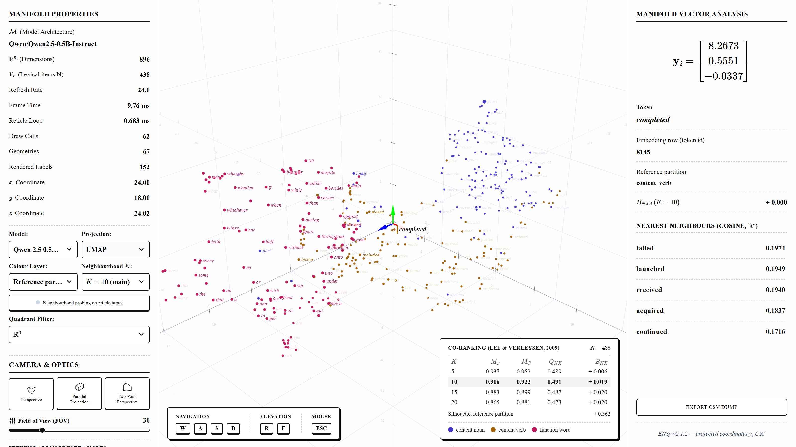
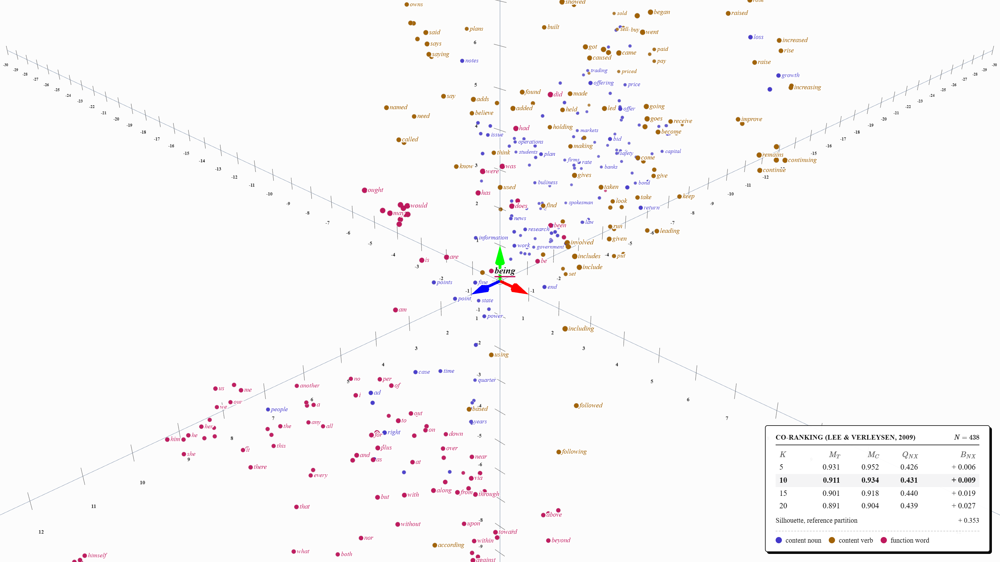
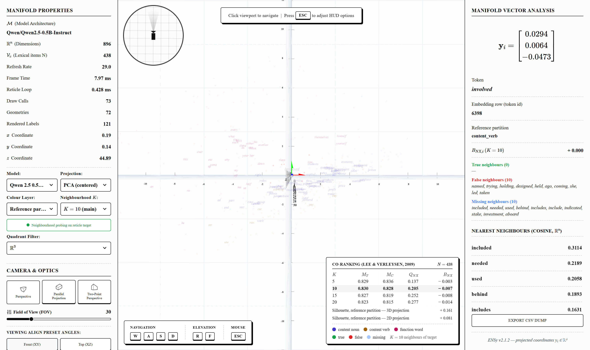
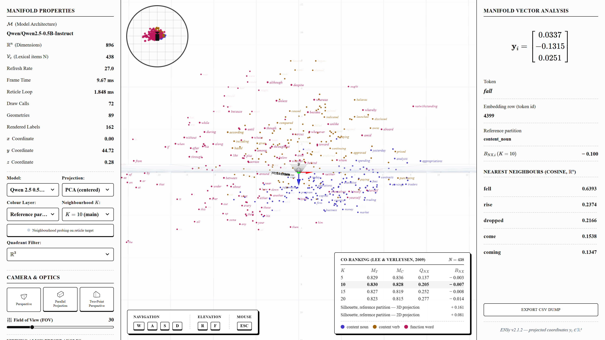

# ENSy — Embedding Navigation System

**Design, Implementation, and Application of an Interactive Embedding Navigation System for Large Language Models**

Undergraduate thesis (TCC) · B.Sc. in Science and Technology – Computer Engineering · Federal University of Maranhão (UFMA), 2026
Author: Alexandre da Silva Santos



The full manuscript with results is in [docs/DOCS.pdf](docs/DOCS.pdf) (LaTeX source: [docs/DOCS.tex](docs/DOCS.tex)).

---

## Overview

**ENSy** is a browser-based research instrument for navigating and quantitatively analyzing the geometry of large language model embedding spaces. It extracts the **static input embedding matrices** of three architectures, projects them onto a navigable 3D manifold with four dimensionality reduction algorithms, and measures how much each projection distorts the original neighborhood structure using the **rank-based co-ranking framework** of Lee & Verleysen (2009).

The research question is not just "what do embeddings look like", but *how each dimensionality reduction algorithm transforms the geometry of the embedding space, for each model architecture* — and how to make those distortions inspectable, token by token.

> ENSy is the instrument that produces the thesis evidence; it is not the object of study itself. It is a local laboratory tool (browser + local FastAPI), not a distributed application.

### Research objectives

| | Objective |
|---|---|
| **O1** | Full-stack rendering of LLM embeddings as navigable 3D manifold approximations |
| **O2** | Comparative analysis across 4 algorithms × 3 models = **12 experimental configurations** |
| **O3** | Quantitative projection quality via co-ranking: $M_T(K)$, $M_C(K)$, $B_{NX}(K)$, $Q_{NX}(K)$, plus Silhouette |
| **O4** | Topological neighborhood inspection through a three-layer color system |
| **O5** | Reproducible protocol: frozen Penn Treebank–derived dataset, frozen hyperparameters, fixed seeds |

---

## Models

Only the input embedding matrix is extracted (`get_input_embeddings().weight` for decoder-only models, `word_embeddings.weight` for BERT) — the token-to-vector lookup before any attention layer, which keeps the three architectures directly comparable. All vectors are cast to `float32` and **L2-normalized**, so cosine similarity and Euclidean distance on the unit hypersphere are equivalent.

| Model | Architecture | Embedding dim $d$ | Vocabulary size |
|---|---|---|---|
| Qwen 2.5 0.5B-Instruct | Decoder-only | 896 | 151,936 |
| Gemma 2B | Decoder-only | 2,048 | 256,000 |
| BERT base uncased | Encoder-only | 768 | 30,522 |

> Because the models differ in architecture, dimension, tokenizer, corpus and training recipe at once, ENSy observes whether distortion patterns *hold or vary* across models — it does not attribute causality to architecture alone.

---

## Dimensionality Reduction



*PCA (linear, maximum variance), t-SNE at perplexity 5 and 30 (local neighbourhoods, not global distances), UMAP (fuzzy topological graph) and Isomap (geodesic distances over a k-NN graph), all on Gemma 2 2B from the same camera (UMAP shown; the paper has all five).*

### Frozen parameter table

All parameters are fixed before data collection. Library defaults are used where possible, so hyperparameters cannot be accused of being tuned after the fact to favor a result.

| Algorithm | Parameter | Value |
|---|---|---|
| PCA | n_components / centering | 3 / yes — **PCA-NC** (non-centered) is an explicit ablation only |
| t-SNE | perplexity / random_state / metric | 5 (small sample) / 42 / cosine |
| UMAP | n_neighbors / min_dist / metric / random_state | 15 / 0.1 / cosine / 42 |
| Isomap | n_neighbors / metric | 15 (comparable to UMAP) / cosine |

High-dimensional neighborhoods use $D_X = D_{\cos}(X)$; evaluation in the projected space uses $D_Y = D_{\text{euclidean}}(Y)$.

---

## Projection Quality — Co-ranking Framework

Given the rank $r_{ij}$ of point $j$ relative to $i$ in high dimension and $\hat r_{ij}$ in the projection, the co-ranking matrix $Q = [q_{kl}]$ counts pairs with $r_{ij}=k$ and $\hat r_{ij}=l$. All metrics are computed as **curves over $K \in \{5, 10, 15, 20\}$** (primary $K = 10$):

| Metric | Meaning |
|---|---|
| **Trustworthiness** $M_T(K)$ | Penalizes false neighbors (severe intrusions) |
| **Continuity** $M_C(K)$ | Penalizes lost neighbors (severe extrusions) |
| **Behavior** $B_{NX}(K) = U_X(K) - U_N(K)$ | $> 0$ intrusive (crowding) · $< 0$ extrusive (tearing) · $\approx 0$ balanced |
| **Preservation** $Q_{NX}(K)$ | Overall K-ary neighborhood preservation |
| **Silhouette** | Separation of the reference linguistic partition in the projected space |

The sign convention of $B_{NX}$ follows the primary source (Lee & Verleysen, 2009, Eq. 22–23). A **per-token decomposition** $B_{NX,i}(K)$ drives the behaviour map, and satisfies the consistency property $B_{NX}(K) = \frac{1}{N}\sum_i B_{NX,i}(K)$, which is checked as an automated test.

---

## Lexical Dataset

The vocabulary is a **lexical dataset derived from the Penn Treebank** (types, not occurrences), with a **reference linguistic partition**: `content_noun` / `content_verb` / `function_word`.

1. Extract PTB tokens → lexical types; normalize case and punctuation
2. Assign reference category; resolve homographs by highest corpus frequency (ambiguous forms are excluded)
3. Tokenize independently with the Qwen, Gemma and BERT tokenizers
4. Keep only forms that map to **exactly one token ID in all three** tokenizers
5. Deduplicate, balance categories, freeze `dataset.json` with its **SHA-256 hash**

The final $N$ is reported as it comes out of the pipeline — it is not inflated to a target (expected range: 150–200 tokens).

---

## Interface

### Three-layer color system

Precedence: **Probing (3) > Behaviour Map (2) > Reference Partition (1)**.

| Layer | Colors |
|---|---|
| **1 — Reference partition** (default) | Indigo = noun · Ochre = verb · Magenta = function word |
| **2 — Behaviour map**, local contribution to $B_{NX}(K)$ | Seven fixed steps (nearest 0.1, capped at ±0.3): blue = extrusive · mid-grey = neutral · red = intrusive; larger dots for larger $\lvert B_{NX,i}\rvert$ |
| **3 — Neighborhood probing** (selected token only) | Green = true neighbors $T_K$ · Red = false $F_K$ · Translucent blue = missing $M_K$ |

### Navigation and inspection

- **6-DOF flight camera** using pointer lock; LERP/SLERP transitions to Front, Top, Side and Isometric presets
- **Perspective, orthographic and two-point perspective** camera modes; adaptive grid, minimap and a fog depth cue
- **Neighbourhood $K$ slider** from 1 to 50 (snaps to the reported 5, 10, 15, 20): every quantity is precomputed, so the behaviour map, the probe and the metrics panel follow while dragging
- **Central reticle selection**: the token nearest the screen center (25 px radius) is selected and inspected in the right sidebar — coordinates, category, $B_{NX,i}(K)$, true/false/missing neighbors with cosine similarity, CSV export
- **Comparative metrics panel**: the 4 models × 5 projection configurations with co-ranking curves
- Rendering uses a single `BufferGeometry` (one draw call) and Projector-style labels: every token is a dot, and words are drawn on one 2D canvas beside their dots, with a white outline, wherever they do not overlap (click a word to pin it); settings persist to `localStorage`
- **TensorFlow Embedding Projector interoperability**: *Export to TF Projector* downloads vectors, metadata, a bookmark per projection with ENSy's exact layout, and `projector_config.json`; *Import from TF Embedding Projector* loads vectors and metadata TSV (and the Projector's bookmark file) and measures the bookmarked layouts as given. Details: [docs/notes/projector_review.md](docs/notes/projector_review.md)

| **Front (XY)** | **Top (XZ)** |
|:---:|:---:|
|  |  |

### Controls

| Input | Action |
|---|---|
| **Click viewport** | Engage pointer lock (flight mode) |
| **`W` / `S`** | Forward / backward |
| **`A` / `D`** | Strafe left / right |
| **`R` / `F`** | Ascend / descend |
| **Mouse** | Pitch / yaw |
| **Scroll** | Zoom |
| **`T`** | Toggle behaviour map layer *(planned)* |
| **`H`** | Toggle navigation HUD |
| **`P`** | Dump diagnostics to the console |
| **`Esc`** | Release pointer lock |

---

## Architecture

```
React 19 + TypeScript + Three.js  ──HTTP──▶  FastAPI + Uvicorn (port 3000)
  App.tsx (state orchestration)                 embedding extraction (PyTorch / Transformers)
  SpaceVisualizer.tsx (WebGL, camera, colors)   in-memory embedding cache
  SidebarLeft / SidebarRight / BottomHUD        PCA · t-SNE · UMAP · Isomap
                                                co-ranking metrics
```

- **Frontend:** React 19, TypeScript, Vite, Three.js, Tailwind CSS, Motion, Lucide React, MathJax 3
- **Backend:** FastAPI, Uvicorn, PyTorch, Transformers, scikit-learn, umap-learn, NumPy, SciPy
- **Testing:** Pytest, Playwright (API contract tests)
- **Docs:** LaTeX paper (`docs/DOCS.tex`, IEEEtran) compiled by Tectonic via `docs/build_pdf.py`; tables and plots generated by `docs/update_results.py`, screenshots by `docs/capture_screenshots.py`

Models load in a background thread at startup. The frontend never shows placeholder data: if the backend is unreachable or a projection fails, it says so.

### API

| Endpoint | Description |
|---|---|
| `GET /api/projection/{model_id}/{engine_type}` | `model_id` ∈ `qwen`, `gemma2`, `gpt2`, `bert` (or an imported `ext-…`); `engine_type` ∈ `umap`, `pca`, `pca_nc`, `tsne`, `tsne_p30`, `isomap` (or a bookmark `bm0`, `bm1`, … of an imported dataset). Returns 3D coordinates, the co-ranking curves and $B_{NX,i}(K)$ for $K = 1 \ldots 50$, and 50 neighbours per token in both spaces |
| `GET /api/export/projector?model=…` | Zip for the TF Embedding Projector: `vectors.tsv`, `metadata.tsv`, `state.txt` (one bookmark per projection), `projector_config.json` |
| `POST /api/import/projector` | JSON with the text of the Projector's vectors TSV, metadata TSV and optional bookmark file; returns the new `ext-…` dataset and its bookmarks |
| `GET /api/external` | Imported datasets (kept in memory until the server restarts) |
| `POST /api/dataset` | Runs the Penn Treebank dataset pipeline; returns `dataset.json` and its SHA-256 hash |

The full response schema is in [Appendix C of the paper](docs/DOCS.pdf).

---

## Quick Start

Requires Node.js and Python 3.12. The npm scripts expect a virtual environment at `.venv/` (Windows paths).

```bash
# Frontend
npm install

# Backend
python -m venv .venv
.venv\Scripts\pip install -r requirements.txt
```

> **Gemma 2 is a gated model.** Accept its licence at
> [huggingface.co/google/gemma-2-2b](https://huggingface.co/google/gemma-2-2b), copy `.env.example`
> to `.env` (git-ignored) and set `HF_TOKEN=hf_...` there.

```bash
# Backend (FastAPI, http://localhost:3000) + frontend (Vite, http://localhost:5173)
python start.py            # or: npm start
python start.py --backend-only   # the backend alone also serves the built frontend (npm run build)
```

`start.py` loads `.env`, checks that ports 3000 and 5173 are free, waits for the backend to be
healthy before starting Vite, prefixes each server's log with `[backend]` / `[frontend]`, and stops
both (child processes included) on Ctrl+C. Separately: `npm run dev:backend` and `npm run dev`.

| Script | Purpose |
|---|---|
| `npm run lint` | TypeScript type check |
| `npm test` | Full Pytest suite |
| `npm run test:api` | API contract tests |
| `npm start` | Start the backend and the frontend (`start.py`) |
| `npm run docs:pdf` | Rebuild `docs/DOCS.pdf` from `docs/DOCS.tex` |

---

## Implementation Status

The thesis specification is ENSy v2 (see the [implementation plan](docs/ENSy_v2.1.2_plano_implementacao.md)). The current codebase is still partway through the migration from the v1 prototype:

| Phase | Item | Status |
|---|---|---|
| 0 | Single-model (Qwen 2.5) pipeline, 4 projection engines, 3D navigation, reticle selection | ✅ Implemented (`GET /api/projection/{engine_type}`) |
| 0 | Remove hard-coded `CLUSTER_MAP`; model abstraction layer for Qwen / Gemma / BERT | ⏳ Pending |
| 0 | Penn Treebank dataset pipeline (`dataset_builder.py`, `POST /api/dataset`) | ⏳ Pending |
| 0 | Single `BufferGeometry` and canvas-sprite labels | ⏳ Pending |
| 1 | Co-ranking matrix, Trustworthiness/Continuity (`metrics.py`) | ⏳ Pending |
| 1 | Synthetic validation of $B_{NX}(K)$ and $B_{NX,i}(K)$ (blocks the behaviour map) | ⏳ Pending |
| 2 | Behaviour map and neighborhood probing | ⏳ Pending |
| 3 | Silhouette and 12-configuration comparison panel | ⏳ Pending |

---

## Limitations

- **Context-free embeddings** by design — contextual hidden states are future work
- **No causal attribution** across models (they differ in many factors at once)
- **Small $N$** — co-ranking indicators may vary more than with larger samples
- **Single-machine** local deployment; tuned for $N$ ≈ 150–200 tokens

---

## Documentation

- [`docs/DOCS.tex`](docs/DOCS.tex) / [`docs/DOCS.pdf`](docs/DOCS.pdf) — full thesis document: theory, architecture, implementation, appendices
- [`docs/ENSy_v2.1.2_plano_implementacao.md`](docs/ENSy_v2.1.2_plano_implementacao.md) — consolidated development plan (Portuguese)

## Key References

- Lee, J. A.; Verleysen, M. *Quality assessment of dimensionality reduction: Rank-based criteria.* Neurocomputing, 72, 2009.
- McInnes, L. et al. *UMAP: Uniform Manifold Approximation and Projection for Dimension Reduction.* arXiv, 2018.
- van der Maaten, L.; Hinton, G. *Visualizing data using t-SNE.* JMLR, 2008.
- Tenenbaum, J. B. et al. *A global geometric framework for nonlinear dimensionality reduction.* Science, 2000.
- Venna, J.; Kaski, S. *Local multidimensional scaling.* Neural Networks, 2006.
- Rousseeuw, P. J. *Silhouettes.* J. Comput. Appl. Math., 1987.
