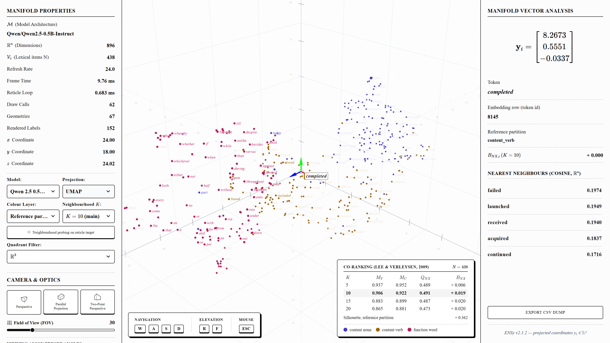
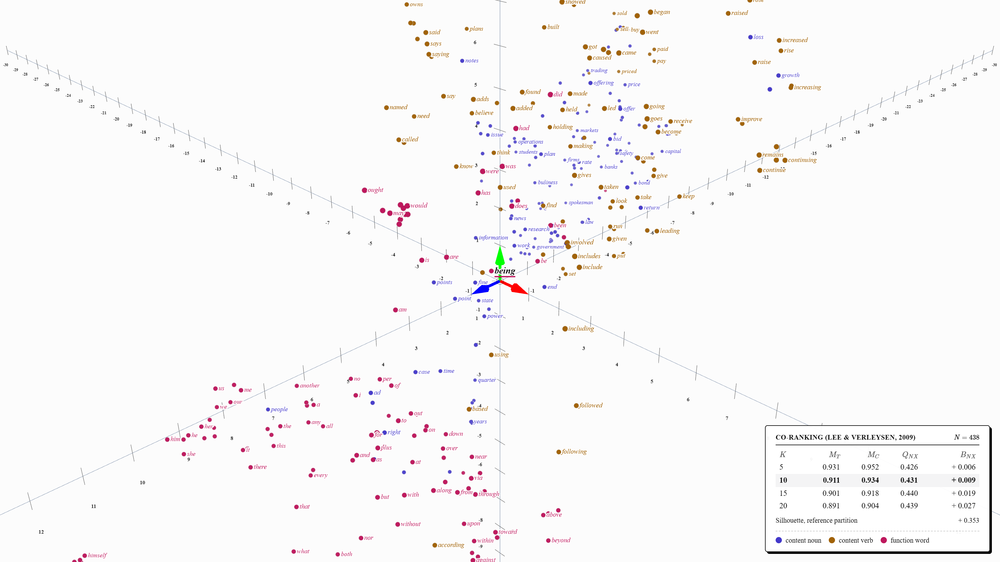
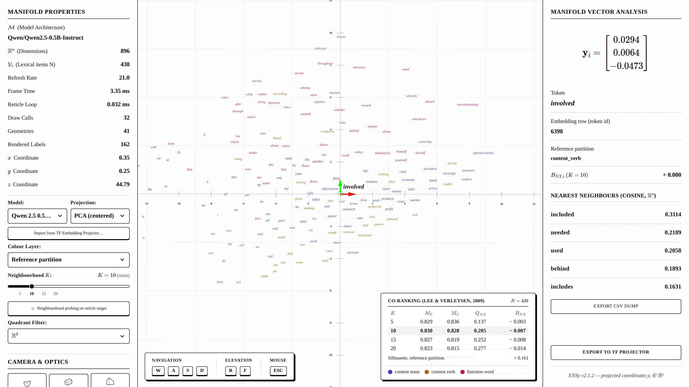
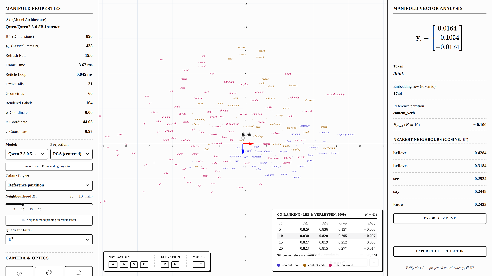

# ENSy — Embedding Navigation System

**Design, Implementation, and Application of an Interactive Embedding Navigation System for Large Language Models**

Undergraduate thesis (TCC) · B.Sc. in Science and Technology – Computer Engineering · Federal University of Maranhão (UFMA), 2026
Author: Alexandre da Silva Santos



The full manuscript with results is in [docs/DOCS.pdf](docs/DOCS.pdf) (LaTeX source: [docs/DOCS.tex](docs/DOCS.tex)).

---

## Overview

**ENSy** is a browser-based research instrument for navigating and quantitatively analyzing the geometry of large language model embedding spaces. It extracts the **static input embedding matrices** of three architectures, projects them onto a navigable 3D manifold with four dimensionality reduction algorithms, and measures how much each projection distorts the original neighborhood structure using the **rank-based co-ranking framework** of Lee & Verleysen (2009).

The research question is not just "what do embeddings look like", but *how each dimensionality reduction algorithm transforms the geometry of the embedding space, for each model architecture* — and how to make those distortions inspectable, token by token.

> ENSy is the instrument that produces the thesis evidence; it is not the object of study itself. It is a local laboratory tool (browser + local FastAPI), not a distributed application.

### Research objectives

<table align="center">
  <thead>
    <tr>
      <th></th>
      <th>Objective</th>
    </tr>
  </thead>
  <tbody>
    <tr>
      <td><strong>O1</strong></td>
      <td>Full-stack rendering of LLM embeddings as navigable 3D manifold approximations</td>
    </tr>
    <tr>
      <td><strong>O2</strong></td>
      <td>Comparative analysis across 4 algorithms × 3 models = <strong>12 experimental configurations</strong></td>
    </tr>
    <tr>
      <td><strong>O3</strong></td>
      <td>Quantitative projection quality via co-ranking: $M_T(K)$, $M_C(K)$, $B_{NX}(K)$, $Q_{NX}(K)$, plus Silhouette</td>
    </tr>
    <tr>
      <td><strong>O4</strong></td>
      <td>Topological neighborhood inspection through a three-layer color system</td>
    </tr>
    <tr>
      <td><strong>O5</strong></td>
      <td>Reproducible protocol: frozen Penn Treebank–derived dataset, frozen hyperparameters, fixed seeds</td>
    </tr>
  </tbody>
</table>


---

## Models

Only the input embedding matrix is extracted (`get_input_embeddings().weight` for decoder-only models, `word_embeddings.weight` for BERT) — the token-to-vector lookup before any attention layer, which keeps the three architectures directly comparable. All vectors are cast to `float32` and **L2-normalized**, so cosine similarity and Euclidean distance on the unit hypersphere are equivalent.

<table align="center">
  <thead>
    <tr>
      <th>Model</th>
      <th>Architecture</th>
      <th>Embedding dim $d$</th>
      <th>Vocabulary size</th>
    </tr>
  </thead>
  <tbody>
    <tr>
      <td>Qwen 2.5 0.5B-Instruct</td>
      <td>Decoder-only</td>
      <td>896</td>
      <td>151,936</td>
    </tr>
    <tr>
      <td>Gemma 2B</td>
      <td>Decoder-only</td>
      <td>2,048</td>
      <td>256,000</td>
    </tr>
    <tr>
      <td>BERT base uncased</td>
      <td>Encoder-only</td>
      <td>768</td>
      <td>30,522</td>
    </tr>
  </tbody>
</table>


> Because the models differ in architecture, dimension, tokenizer, corpus and training recipe at once, ENSy observes whether distortion patterns *hold or vary* across models — it does not attribute causality to architecture alone.

---

## Dimensionality Reduction



*PCA (linear, maximum variance), t-SNE at perplexity 5 and 30 (local neighbourhoods, not global distances), UMAP (fuzzy topological graph) and Isomap (geodesic distances over a k-NN graph), all on Gemma 2 2B from the same camera (UMAP shown; the paper has all five).*

### Frozen parameter table

All parameters are fixed before data collection. Library defaults are used where possible, so hyperparameters cannot be accused of being tuned after the fact to favor a result.

<table align="center">
  <thead>
    <tr>
      <th>Algorithm</th>
      <th>Parameter</th>
      <th>Value</th>
    </tr>
  </thead>
  <tbody>
    <tr>
      <td>PCA</td>
      <td>n_components / centering</td>
      <td>3 / yes — <strong>PCA-NC</strong> (non-centered) is an explicit ablation only</td>
    </tr>
    <tr>
      <td>t-SNE</td>
      <td>perplexity / random_state / metric</td>
      <td>5 (small sample) / 42 / cosine</td>
    </tr>
    <tr>
      <td>UMAP</td>
      <td>n_neighbors / min_dist / metric / random_state</td>
      <td>15 / 0.1 / cosine / 42</td>
    </tr>
    <tr>
      <td>Isomap</td>
      <td>n_neighbors / metric</td>
      <td>15 (comparable to UMAP) / cosine</td>
    </tr>
  </tbody>
</table>


High-dimensional neighborhoods use $D_X = D_{\cos}(X)$; evaluation in the projected space uses $D_Y = D_{\text{euclidean}}(Y)$.

---

## Projection Quality — Co-ranking Framework

Given the rank $r_{ij}$ of point $j$ relative to $i$ in high dimension and $\hat r_{ij}$ in the projection, the co-ranking matrix $Q = [q_{kl}]$ counts pairs with $r_{ij}=k$ and $\hat r_{ij}=l$. All metrics are computed as **curves over $K \in \{5, 10, 15, 20\}$** (primary $K = 10$):

<table align="center">
  <thead>
    <tr>
      <th>Metric</th>
      <th>Meaning</th>
    </tr>
  </thead>
  <tbody>
    <tr>
      <td><strong>Trustworthiness</strong> $M_T(K)$</td>
      <td>Penalizes false neighbors (severe intrusions)</td>
    </tr>
    <tr>
      <td><strong>Continuity</strong> $M_C(K)$</td>
      <td>Penalizes lost neighbors (severe extrusions)</td>
    </tr>
    <tr>
      <td><strong>Behavior</strong> $B_{NX}(K) = U_X(K) - U_N(K)$</td>
      <td>$> 0$ intrusive (crowding) · $< 0$ extrusive (tearing) · $\approx 0$ balanced</td>
    </tr>
    <tr>
      <td><strong>Preservation</strong> $Q_{NX}(K)$</td>
      <td>Overall K-ary neighborhood preservation</td>
    </tr>
    <tr>
      <td><strong>Silhouette</strong></td>
      <td>Separation of the reference linguistic partition in the projected space</td>
    </tr>
  </tbody>
</table>


The sign convention of $B_{NX}$ follows the primary source (Lee & Verleysen, 2009, Eq. 22–23). A **per-token decomposition** $B_{NX,i}(K)$ drives the behaviour map, and satisfies the consistency property $B_{NX}(K) = \frac{1}{N}\sum_i B_{NX,i}(K)$, which is checked as an automated test.

---

## Lexical Dataset

The vocabulary is a **lexical dataset derived from the Penn Treebank** (types, not occurrences), with a **reference linguistic partition**: `content_noun` / `content_verb` / `function_word`.

1. Extract PTB tokens → lexical types; normalize case and punctuation
2. Assign reference category; resolve homographs by highest corpus frequency (ambiguous forms are excluded)
3. Tokenize independently with the Qwen, Gemma and BERT tokenizers
4. Keep only forms that map to **exactly one token ID in all three** tokenizers
5. Deduplicate, balance categories, freeze `dataset.json` with its **SHA-256 hash**

The final $N$ is reported as it comes out of the pipeline — it is not inflated to a target (expected range: 150–200 tokens).

---

## Interface

### Three-layer color system

Precedence: **Probing (3) > Behaviour Map (2) > Reference Partition (1)**.

<table align="center">
  <thead>
    <tr>
      <th>Layer</th>
      <th>Colors</th>
    </tr>
  </thead>
  <tbody>
    <tr>
      <td><strong>1 — Reference partition</strong> (default)</td>
      <td>Indigo = noun · Ochre = verb · Magenta = function word</td>
    </tr>
    <tr>
      <td><strong>2 — Behaviour map</strong>, local contribution to $B_{NX}(K)$</td>
      <td>Seven fixed steps (nearest 0.1, capped at ±0.3): blue = extrusive · mid-grey = neutral · red = intrusive; larger dots for larger $\lvert B_{NX,i}\rvert$</td>
    </tr>
    <tr>
      <td><strong>3 — Neighborhood probing</strong> (selected token only)</td>
      <td>Green = true neighbors $T_K$ · Red = false $F_K$ · Translucent blue = missing $M_K$</td>
    </tr>
  </tbody>
</table>


### Navigation and inspection

- **6-DOF flight camera** using pointer lock; LERP/SLERP transitions to Front, Top, Side and Isometric presets
- **Perspective, orthographic and two-point perspective** camera modes; adaptive grid, minimap and a fog depth cue
- **Neighbourhood $K$ slider** from 1 to 50 (snaps to the reported 5, 10, 15, 20): every quantity is precomputed, so the behaviour map, the probe and the metrics panel follow while dragging
- **Central reticle selection**: the token nearest the screen center (25 px radius) is selected and inspected in the right sidebar — coordinates, category, $B_{NX,i}(K)$, true/false/missing neighbors with cosine similarity, CSV export
- **Comparative metrics panel**: the 4 models × 5 projection configurations with co-ranking curves
- Rendering uses a single `BufferGeometry` (one draw call) and Projector-style labels: every token is a dot, and words are drawn on one 2D canvas beside their dots, with a white outline, wherever they do not overlap (click a word to pin it); settings persist to `localStorage`
- **TensorFlow Embedding Projector interoperability**: *Export to TF Projector* downloads vectors, metadata, a bookmark per projection with ENSy's exact layout, and `projector_config.json`; *Import from TF Embedding Projector* loads vectors and metadata TSV (and the Projector's bookmark file) and measures the bookmarked layouts as given. Details: [docs/notes/projector_review.md](docs/notes/projector_review.md)
- **Gamepad navigation and presentation remote**: with a gamepad connected, the left stick moves, the right stick looks and the triggers ascend/descend, without pointer lock. The floating *Presentation Remote* panel saves the current view (token, $K$, zoom) as a step; `Y`/Triangle toggles presentation mode, where `L1`/`R1` step back and forward through the saved views. Steps persist in `localStorage`
- **Deep links**: URL parameters open the app on a given state and override the stored session — `?model=` (`qwen`, `gemma2`, `gpt2`, `bert`, `ext-…`), `?algorithm=` (`umap`, `tsne`, `tsne_p30`, `pca`, `isomap`, `pca_nc`), `?k=`, `?focus=<token or id>` with `&zoom=` (<1 closer) and `&animate=false`, or an exact camera pose with all six of `camX camY camZ camRX camRY camRZ` (takes priority over `focus`)

<table align="center">
  <thead>
    <tr>
      <th><strong>Front (XY)</strong></th>
      <th><strong>Top (XZ)</strong></th>
    </tr>
  </thead>
  <tbody>
    <tr>
      <td></td>
      <td></td>
    </tr>
  </tbody>
</table>


### Controls

<table align="center">
  <thead>
    <tr>
      <th>Input</th>
      <th>Action</th>
    </tr>
  </thead>
  <tbody>
    <tr>
      <td><strong>Click viewport</strong></td>
      <td>Engage pointer lock (flight mode)</td>
    </tr>
    <tr>
      <td><strong><code>W</code> / <code>S</code></strong></td>
      <td>Forward / backward</td>
    </tr>
    <tr>
      <td><strong><code>A</code> / <code>D</code></strong></td>
      <td>Strafe left / right</td>
    </tr>
    <tr>
      <td><strong><code>R</code> / <code>F</code></strong></td>
      <td>Ascend / descend</td>
    </tr>
    <tr>
      <td><strong>Mouse</strong></td>
      <td>Pitch / yaw</td>
    </tr>
    <tr>
      <td><strong>Scroll</strong></td>
      <td>Zoom</td>
    </tr>
    <tr>
      <td><strong><code>T</code></strong></td>
      <td>Toggle behaviour map layer *(planned)*</td>
    </tr>
    <tr>
      <td><strong><code>H</code></strong></td>
      <td>Toggle navigation HUD</td>
    </tr>
    <tr>
      <td><strong><code>P</code></strong></td>
      <td>Dump diagnostics to the console</td>
    </tr>
    <tr>
      <td><strong><code>Esc</code></strong></td>
      <td>Release pointer lock</td>
    </tr>
    <tr>
      <td><strong>Gamepad left / right stick</strong></td>
      <td>Move / look</td>
    </tr>
    <tr>
      <td><strong>Gamepad triggers</strong></td>
      <td>Ascend / descend</td>
    </tr>
    <tr>
      <td><strong>Gamepad <code>Y</code> / Triangle</strong></td>
      <td>Toggle presentation mode</td>
    </tr>
    <tr>
      <td><strong>Gamepad <code>L1</code> / <code>R1</code></strong></td>
      <td>Previous / next saved view (presentation mode)</td>
    </tr>
  </tbody>
</table>


---

## Architecture

```
React 19 + TypeScript + Three.js  ──HTTP──▶  FastAPI + Uvicorn (port 3000)
  App.tsx (state orchestration)                 embedding extraction (PyTorch / Transformers)
  SpaceVisualizer.tsx (WebGL, camera, colors)   in-memory embedding cache
  SidebarLeft / SidebarRight / BottomHUD        PCA · t-SNE · UMAP · Isomap
                                                co-ranking metrics
```

- **Frontend:** React 19, TypeScript, Vite, Three.js, Tailwind CSS, Motion, Lucide React, MathJax 3
- **Backend:** FastAPI, Uvicorn, PyTorch, Transformers, scikit-learn, umap-learn, NumPy, SciPy
- **Testing:** Pytest, Playwright (API contract tests)
- **Docs:** LaTeX paper (`docs/DOCS.tex`, IEEEtran) compiled by Tectonic via `docs/build_pdf.py`; tables and plots generated by `docs/update_results.py`, screenshots by `docs/capture_screenshots.py`

Models load in a background thread at startup. The frontend never shows placeholder data: if the backend is unreachable or a projection fails, it says so.

### API

<table align="center">
  <thead>
    <tr>
      <th>Endpoint</th>
      <th>Description</th>
    </tr>
  </thead>
  <tbody>
    <tr>
      <td><code>GET /api/projection/{model_id}/{engine_type}</code></td>
      <td><code>model_id</code> ∈ <code>qwen</code>, <code>gemma2</code>, <code>gpt2</code>, <code>bert</code> (or an imported <code>ext-…</code>); <code>engine_type</code> ∈ <code>umap</code>, <code>pca</code>, <code>pca_nc</code>, <code>tsne</code>, <code>tsne_p30</code>, <code>isomap</code> (or a bookmark <code>bm0</code>, <code>bm1</code>, … of an imported dataset). Returns 3D coordinates, the co-ranking curves and $B_{NX,i}(K)$ for $K = 1 \ldots 50$, and 50 neighbours per token in both spaces</td>
    </tr>
    <tr>
      <td><code>GET /api/export/projector?model=…</code></td>
      <td>Zip for the TF Embedding Projector: <code>vectors.tsv</code>, <code>metadata.tsv</code>, <code>state.txt</code> (one bookmark per projection), <code>projector_config.json</code></td>
    </tr>
    <tr>
      <td><code>POST /api/import/projector</code></td>
      <td>JSON with the text of the Projector's vectors TSV, metadata TSV and optional bookmark file; returns the new <code>ext-…</code> dataset and its bookmarks</td>
    </tr>
    <tr>
      <td><code>GET /api/external</code></td>
      <td>Imported datasets (kept in memory until the server restarts)</td>
    </tr>
    <tr>
      <td><code>POST /api/dataset</code></td>
      <td>Runs the Penn Treebank dataset pipeline; returns <code>dataset.json</code> and its SHA-256 hash</td>
    </tr>
  </tbody>
</table>


The full response schema is in [Appendix C of the paper](docs/DOCS.pdf).

---

## Quick Start

Requires Node.js and Python 3.12. The npm scripts expect a virtual environment at `.venv/` (Windows paths).

```bash
# Frontend
npm install

# Backend
python -m venv .venv
.venv\Scripts\pip install -r requirements.txt
```

> **Gemma 2 is a gated model.** Accept its licence at
> [huggingface.co/google/gemma-2-2b](https://huggingface.co/google/gemma-2-2b), copy `.env.example`
> to `.env` (git-ignored) and set `HF_TOKEN=hf_...` there.

```bash
# Backend (FastAPI, http://localhost:3000) + frontend (Vite, http://localhost:5173)
python start.py            # or: npm start
python start.py --backend-only   # the backend alone also serves the built frontend (npm run build)
```

`start.py` loads `.env`, checks that ports 3000 and 5173 are free, waits for the backend to be
healthy before starting Vite, prefixes each server's log with `[backend]` / `[frontend]`, and stops
both (child processes included) on Ctrl+C. Separately: `npm run dev:backend` and `npm run dev`.

<table align="center">
  <thead>
    <tr>
      <th>Script</th>
      <th>Purpose</th>
    </tr>
  </thead>
  <tbody>
    <tr>
      <td><code>npm run lint</code></td>
      <td>TypeScript type check</td>
    </tr>
    <tr>
      <td><code>npm test</code></td>
      <td>Full Pytest suite</td>
    </tr>
    <tr>
      <td><code>npm run test:api</code></td>
      <td>API contract tests</td>
    </tr>
    <tr>
      <td><code>npm start</code></td>
      <td>Start the backend and the frontend (<code>start.py</code>)</td>
    </tr>
    <tr>
      <td><code>npm run docs:pdf</code></td>
      <td>Rebuild <code>docs/DOCS.pdf</code> from <code>docs/DOCS.tex</code></td>
    </tr>
  </tbody>
</table>


---

## Implementation Status

The thesis specification is ENSy v2 (see the [implementation plan](docs/ENSy_v2.1.2_plano_implementacao.md)). The current codebase is still partway through the migration from the v1 prototype:

<table align="center">
  <thead>
    <tr>
      <th>Phase</th>
      <th>Item</th>
      <th>Status</th>
    </tr>
  </thead>
  <tbody>
    <tr>
      <td>0</td>
      <td>Single-model (Qwen 2.5) pipeline, 4 projection engines, 3D navigation, reticle selection</td>
      <td>✅ Implemented (<code>GET /api/projection/{engine_type}</code>)</td>
    </tr>
    <tr>
      <td>0</td>
      <td>Remove hard-coded <code>CLUSTER_MAP</code>; model abstraction layer for Qwen / Gemma / BERT</td>
      <td>⏳ Pending</td>
    </tr>
    <tr>
      <td>0</td>
      <td>Penn Treebank dataset pipeline (<code>dataset_builder.py</code>, <code>POST /api/dataset</code>)</td>
      <td>⏳ Pending</td>
    </tr>
    <tr>
      <td>0</td>
      <td>Single <code>BufferGeometry</code> and canvas-sprite labels</td>
      <td>⏳ Pending</td>
    </tr>
    <tr>
      <td>1</td>
      <td>Co-ranking matrix, Trustworthiness/Continuity (<code>metrics.py</code>)</td>
      <td>⏳ Pending</td>
    </tr>
    <tr>
      <td>1</td>
      <td>Synthetic validation of $B_{NX}(K)$ and $B_{NX,i}(K)$ (blocks the behaviour map)</td>
      <td>⏳ Pending</td>
    </tr>
    <tr>
      <td>2</td>
      <td>Behaviour map and neighborhood probing</td>
      <td>⏳ Pending</td>
    </tr>
    <tr>
      <td>3</td>
      <td>Silhouette and 12-configuration comparison panel</td>
      <td>⏳ Pending</td>
    </tr>
  </tbody>
</table>


---

## Limitations

- **Context-free embeddings** by design — contextual hidden states are future work
- **No causal attribution** across models (they differ in many factors at once)
- **Small $N$** — co-ranking indicators may vary more than with larger samples
- **Single-machine** local deployment; tuned for $N$ ≈ 150–200 tokens

---

## Documentation

- [`docs/DOCS.tex`](docs/DOCS.tex) / [`docs/DOCS.pdf`](docs/DOCS.pdf) — full thesis document: theory, architecture, implementation, appendices
- [`docs/ENSy_v2.1.2_plano_implementacao.md`](docs/ENSy_v2.1.2_plano_implementacao.md) — consolidated development plan (Portuguese)

## Key References

- Lee, J. A.; Verleysen, M. *Quality assessment of dimensionality reduction: Rank-based criteria.* Neurocomputing, 72, 2009.
- McInnes, L. et al. *UMAP: Uniform Manifold Approximation and Projection for Dimension Reduction.* arXiv, 2018.
- van der Maaten, L.; Hinton, G. *Visualizing data using t-SNE.* JMLR, 2008.
- Tenenbaum, J. B. et al. *A global geometric framework for nonlinear dimensionality reduction.* Science, 2000.
- Venna, J.; Kaski, S. *Local multidimensional scaling.* Neural Networks, 2006.
- Rousseeuw, P. J. *Silhouettes.* J. Comput. Appl. Math., 1987.
