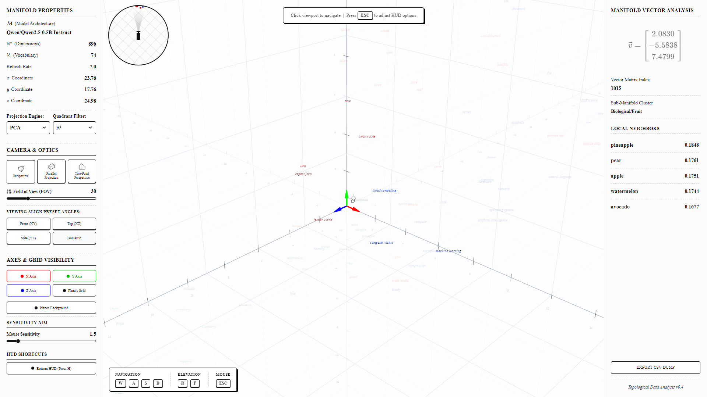
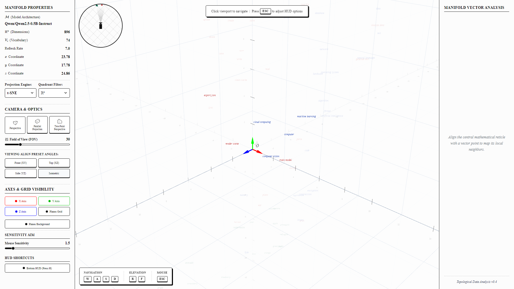
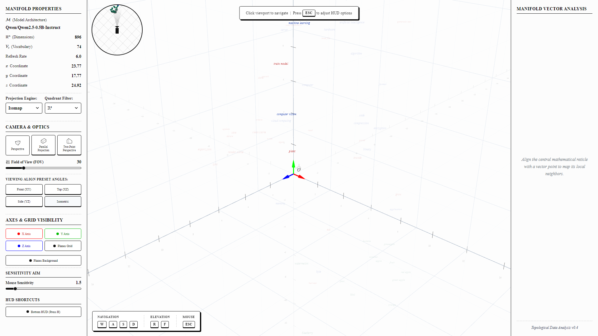

# ENSy — Embedding Navigation System

**An interactive 3D browser-based instrument for exploring static language-model embeddings.**

ENSy is an undergraduate thesis project (TCC) in Science and Technology / Computer Engineering at the Federal University of Maranhão (UFMA), 2026.


> **Project status:** the current repository contains the v1 prototype and its interactive visualizer. The broader v2 research design—three-model comparison, a Penn Treebank-derived lexical dataset, co-ranking metrics, and token-level neighborhood diagnostics—is documented as the target implementation, but is not yet implemented end to end. This README distinguishes working prototype behavior from planned research features.

## What works in the current prototype

- A React 19, TypeScript, Vite, and Three.js interface for exploring a 3D point cloud.
- A local FastAPI backend that can load the Qwen 2.5 0.5B-Instruct input embedding matrix.
- Four projection engines: **UMAP, PCA, t-SNE, and Isomap**.
- Token selection and inspection, including token metadata and the five nearest neighbors ranked by cosine similarity.
- Perspective, orthographic/parallel, and two-point camera modes; camera presets; axis and grid controls; keyboard flight navigation.
- CSV export of the selected token's nearest-neighbor list.
- A static frontend dataset as a fallback when the local API is unavailable.

### Important interpretation note

The current prototype starts from a hard-coded set of candidate words in three illustrative clusters. Before the Qwen model finishes loading, the backend uses deterministic pseudo-vectors so the interface can start without waiting for a model download. If the model loads successfully, candidate words that tokenize to more than one token are excluded.

**A projection shown during bootstrap or in the static fallback is not a measured result from the language model.** The current prototype also does not yet calculate the co-ranking metrics described in the thesis plan.

## Screenshots

| PCA | t-SNE | Isomap |
|:---:|:---:|:---:|
|  |  |  |

## Architecture

```text
React 19 + TypeScript + Three.js
             |
             | HTTP: GET /api/projection/{engine_type}
             v
       Local FastAPI + Uvicorn
             |
             +-- Qwen 2.5 0.5B input embeddings (when loaded)
             +-- UMAP / PCA / t-SNE / Isomap
             +-- cosine-similarity nearest neighbors
```

**Frontend:** React, TypeScript, Vite, Three.js, Tailwind CSS, Motion, Lucide React, MathJax.

**Backend:** FastAPI, Uvicorn, PyTorch, Transformers, scikit-learn, umap-learn, NumPy, SciPy.

### Current API

| Endpoint | Behavior |
|---|---|
| `GET /api/projection/umap` | Compute a UMAP projection |
| `GET /api/projection/pca` | Compute a PCA projection |
| `GET /api/projection/tsne` | Compute a t-SNE projection |
| `GET /api/projection/isomap` | Compute an Isomap projection |

The response contains status and model metadata, projected coordinates, token/cluster information, and up to five nearest neighbors with cosine similarity. The current backend does **not** expose the planned `/api/projection/{model_id}/{engine_type}` or `POST /api/dataset` endpoints.

## Run locally

The npm scripts currently use Windows virtual-environment paths. The steps below target **Windows PowerShell**, Node.js, and Python 3.12.

```powershell
npm install
python -m venv .venv
.\.venv\Scripts\python.exe -m pip install -r requirements.txt
npm run dev:all
```

The Vite frontend is available at [http://localhost:5173](http://localhost:5173), and the FastAPI backend listens on [http://127.0.0.1:3000](http://127.0.0.1:3000).

The backend attempts to download Qwen 2.5 0.5B-Instruct from Hugging Face at startup. The first run therefore requires network access and enough local memory to load the model. If loading fails, the server logs the error and continues with bootstrap pseudo-vectors.

### Useful commands

| Command | Purpose |
|---|---|
| `npm run dev` | Start the Vite frontend |
| `npm run dev:backend` | Start the FastAPI backend |
| `npm run dev:all` | Start frontend and backend together |
| `npm run lint` | Run the TypeScript type check |
| `npm test` | Run API and screenshot tests |
| `npm run test:api` | Run backend API contract tests |
| `npm run test:screenshots` | Run headed Playwright screenshot tests |
| `npm run test:screenshots:headless` | Run Playwright screenshot tests headlessly |

The API tests require the backend to be running. Screenshot tests require the frontend and Playwright's browser dependencies. API tests skip individual requests if the backend is unreachable; a skipped test is not a passing verification of the endpoint.

## Research direction: ENSy v2

The thesis plan extends the prototype into a controlled comparison of static input embedding spaces. These are **planned research features**, not claims about the current implementation:

- Compare Qwen 2.5 0.5B-Instruct, Gemma 2B, and BERT base uncased.
- Build and freeze a balanced lexical dataset derived from the Penn Treebank, retaining forms that tokenize to exactly one token in all three models.
- Compare PCA, t-SNE, UMAP, and Isomap across 12 model/algorithm configurations.
- Implement co-ranking-based Trustworthiness, Continuity, $B_{NX}(K)$, and $Q_{NX}(K)$, plus Silhouette as a complementary measure.
- Add token-level neighborhood probing and a thermal visualization of local projection behavior.
- Freeze dataset, parameters, and random seeds to support reproducibility.

The research design explicitly avoids attributing observed differences to architecture alone: the models also differ in embedding dimension, tokenizer, training corpus, and training objective.

## Documentation

- [Full thesis documentation](docs/DOCS.md) · [PDF version](docs/DOCS.pdf)
- [ENSy v2.1.2 implementation plan](docs/ENSy_v2.1.2_plano_implementacao.md) (Portuguese)

## References

- Lee, J. A.; Verleysen, M. *Quality assessment of dimensionality reduction: Rank-based criteria.* Neurocomputing, 72, 2009.
- McInnes, L. et al. *UMAP: Uniform Manifold Approximation and Projection for Dimension Reduction.* 2018.
- van der Maaten, L.; Hinton, G. *Visualizing data using t-SNE.* JMLR, 2008.
- Tenenbaum, J. B. et al. *A global geometric framework for nonlinear dimensionality reduction.* Science, 2000.
- Rousseeuw, P. J. *Silhouettes.* Journal of Computational and Applied Mathematics, 1987.
