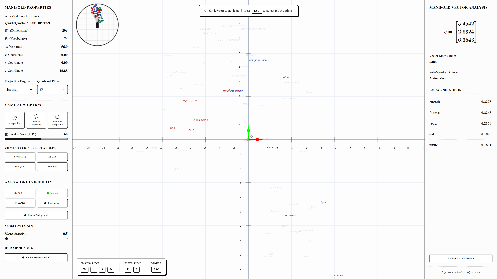
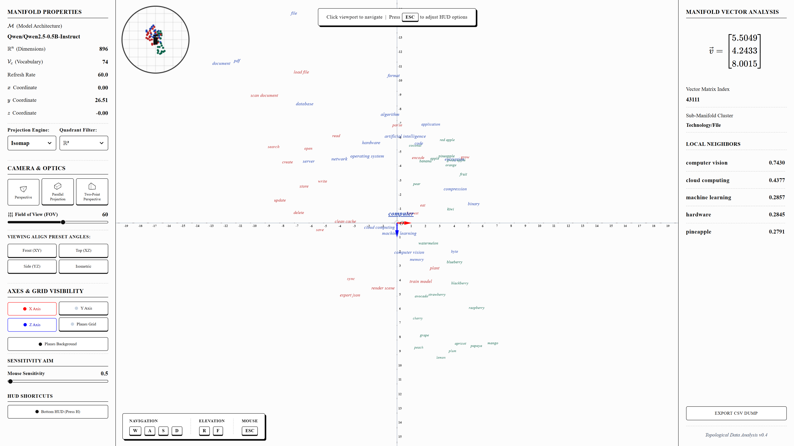

# Semantic Manifold Vector Visualizer (SMVV)


## Overview

The **Semantic Manifold Vector Visualizer (SMVV)** is an interactive, browser-based 3D computational workbench designed for the qualitative analysis, geometric exploration, and topological interpretation of high-dimensional semantic vector spaces. By projecting neural language model embeddings (e.g., Qwen 2.5 0.5B-Instruct) onto a continuous Three.js-powered Cartesian manifold, researchers and students can evaluate cosine similarities, cluster geometries, and local neighborhood topology in real time.

---

## Dimensionality Reduction Projections

The system dynamically reduces 896-dimensional embedding vectors into navigable 3D manifolds via four algorithms:

| **UMAP (Cosine Metric)** | **PCA (Maximum Variance)** |
|:---:|:---:|
|  |  |
| *Preserves local and global topological structure* | *Linear projection maximizing global variance* |

| **t-SNE (Probabilistic)** | **Isomap (Geodesic Distance)** |
|:---:|:---:|
|  |  |
| *Highlights localized cluster segregation* | *Preserves geodesic neighborhood graph distances* |

---

## Core Capabilities

### 1. 3D Spatial Navigation & Camera Optics
- **Real-Time WebGL Rendering:** Powered by `Three.js` at 60 FPS with exponential depth fog and responsive Cartesian coordinate planes.
- **6-DOF Flight Controls:** Unconstrained traversal using `WASD` (translation), `R`/`F` (elevation), and mouse pointer-lock (pitch/yaw).
- **Cinematic Interpolation (LERP / SLERP):** Smooth animated camera transitions between orthogonal presets (Front, Top, Side) and Isometric views.

| **Front (XY Plane)** | **Top (XZ Aerial)** |
|:---:|:---:|
|  |  |

### 2. Topological Neighborhood Inspection
- **Screen-Space Reticle Selection:** Aligning the central crosshair with any token node locks onto the vector and resolves its immediate metric context.
- **Cosine Similarity Ranking:** Instantly computes and displays the top-5 nearest semantic neighbors by angular distance.
- **CSV Data Export:** Direct export of active local neighborhoods to `.csv` manifests for reproducible downstream statistical analysis.

### 3. Academic-Grade Visual Processing
- **Dynamic Occlusion & Depth Sorting:** Distance-based Z-indexing and NDC projection ensure readable labels without visual clipping.
- **Mathematical Typography:** Integrated LaTeX equation rendering (via MathJax 3) for vector coordinates ($\vec{v}$) and metrics.
- **Cartesian Apparatus:** Toggleable axes (X, Y, Z), reference grids, and adaptive tick resolutions that adjust to camera zoom.

---

## Technical Stack

- **Frontend:** React 19, TypeScript, Vite, Three.js, Tailwind CSS, Lucide React, Motion
- **Backend:** FastAPI, Uvicorn, PyTorch, Transformers (Qwen 2.5 0.5B-Instruct), scikit-learn, UMAP-learn, NumPy
- **Document Engine:** Playwright, Markdown, MathJax (automated publication PDF generation)

---

## Quick Start

### 1. Install Dependencies

```bash
# Frontend
npm install

# Backend
pip install -r requirements.txt
```

### 2. Run the Application

```bash
# Run both Frontend (Vite) and Backend (FastAPI) concurrently
npm run dev:all
```

Or run them in separate terminals:
- **Frontend:** `npm run dev` (available at `http://localhost:5173`)
- **Backend:** `npm run dev:backend` (available at `http://127.0.0.1:3000`)

---

## Controls Reference

| Control | Action |
| --- | --- |
| **Click Canvas** | Engage pointer lock (flight mode) |
| **`W` / `S`** | Move Forward / Backward |
| **`A` / `D`** | Strafe Left / Right |
| **`R` / `F`** | Ascend / Descend |
| **Mouse Move** | Look around (Pitch / Yaw) |
| **Scroll Wheel** | Zoom in / out |
| **`H`** | Toggle Navigation HUD |
| **`Esc`** | Release pointer lock |

---

## Scientific Documentation

Comprehensive academic documentation, theoretical derivations, and architectural specifications are available in:
- [`docs/DOCS.md`](docs/DOCS.md) — Complete academic document.
- [`docs/DOCS.pdf`](docs/DOCS.pdf) — Generated PDF document with rendered MathJax equations.
- Run `python docs/md_to_pdf.py` to regenerate the PDF.
