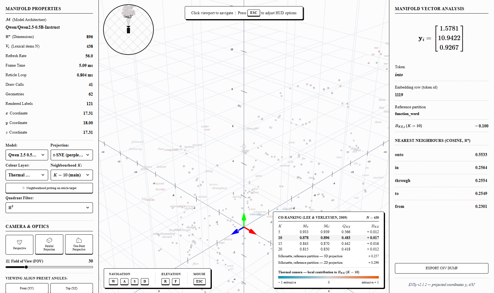
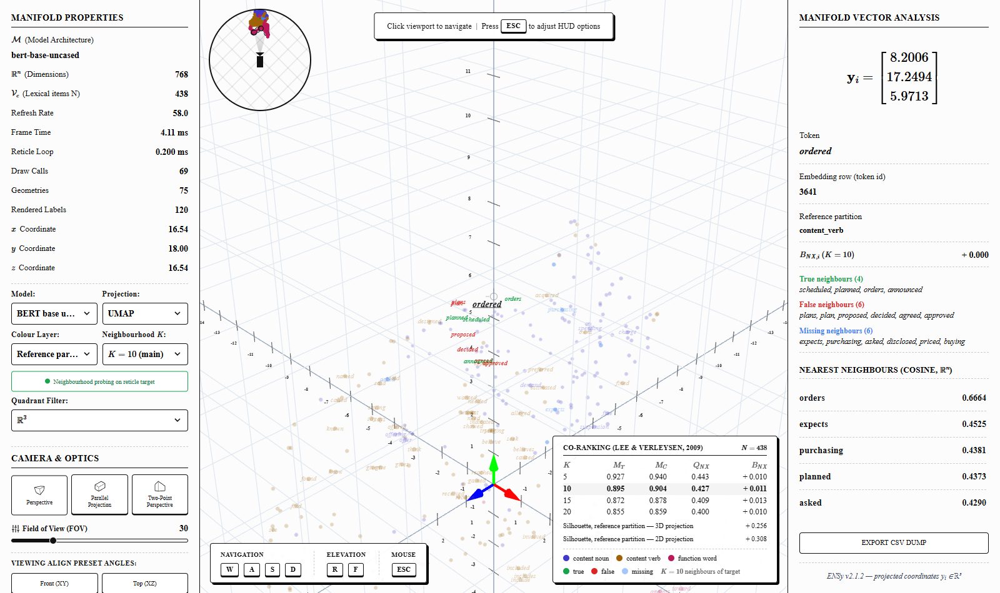
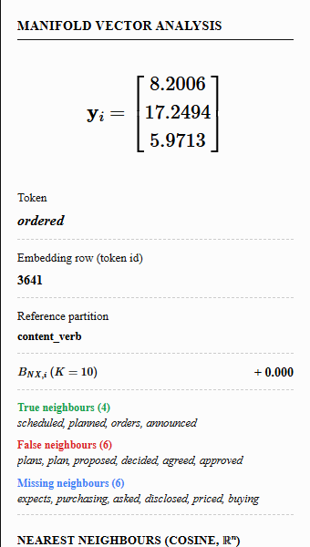
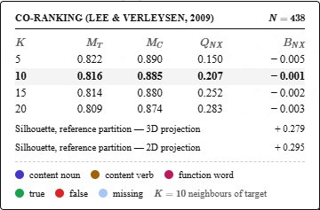
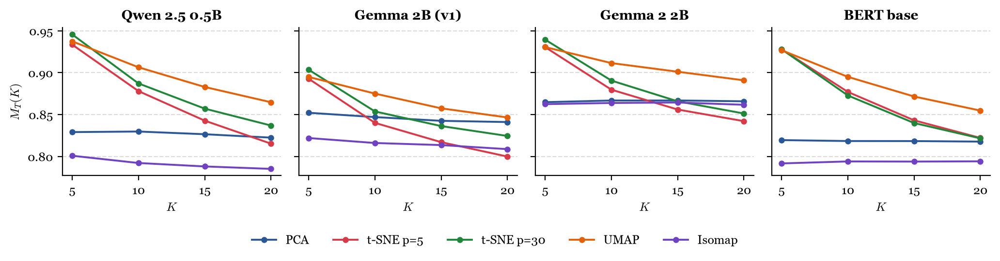
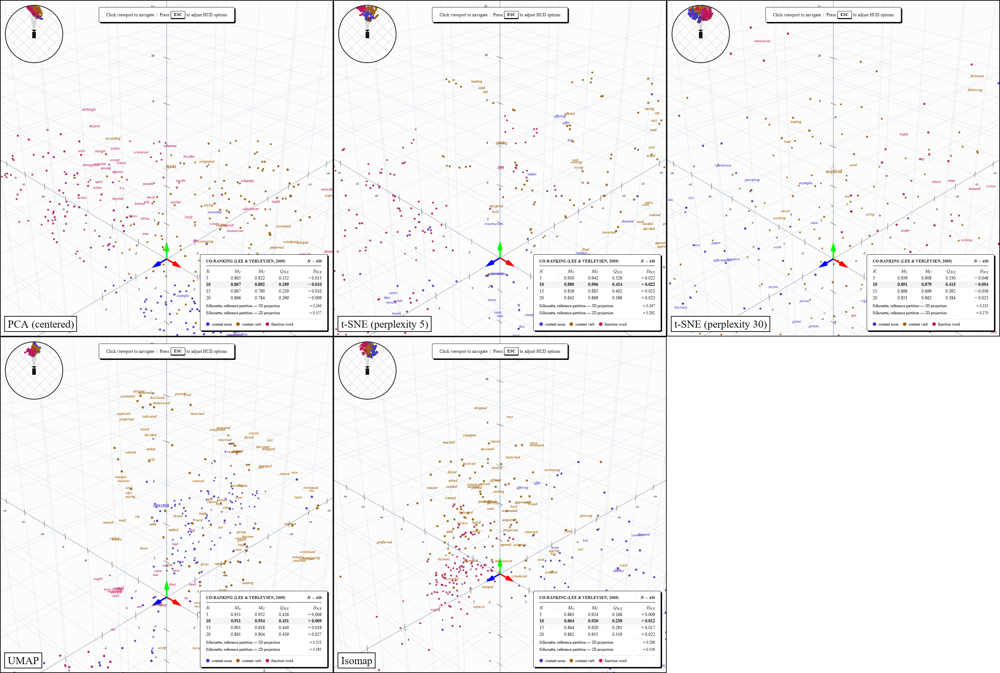
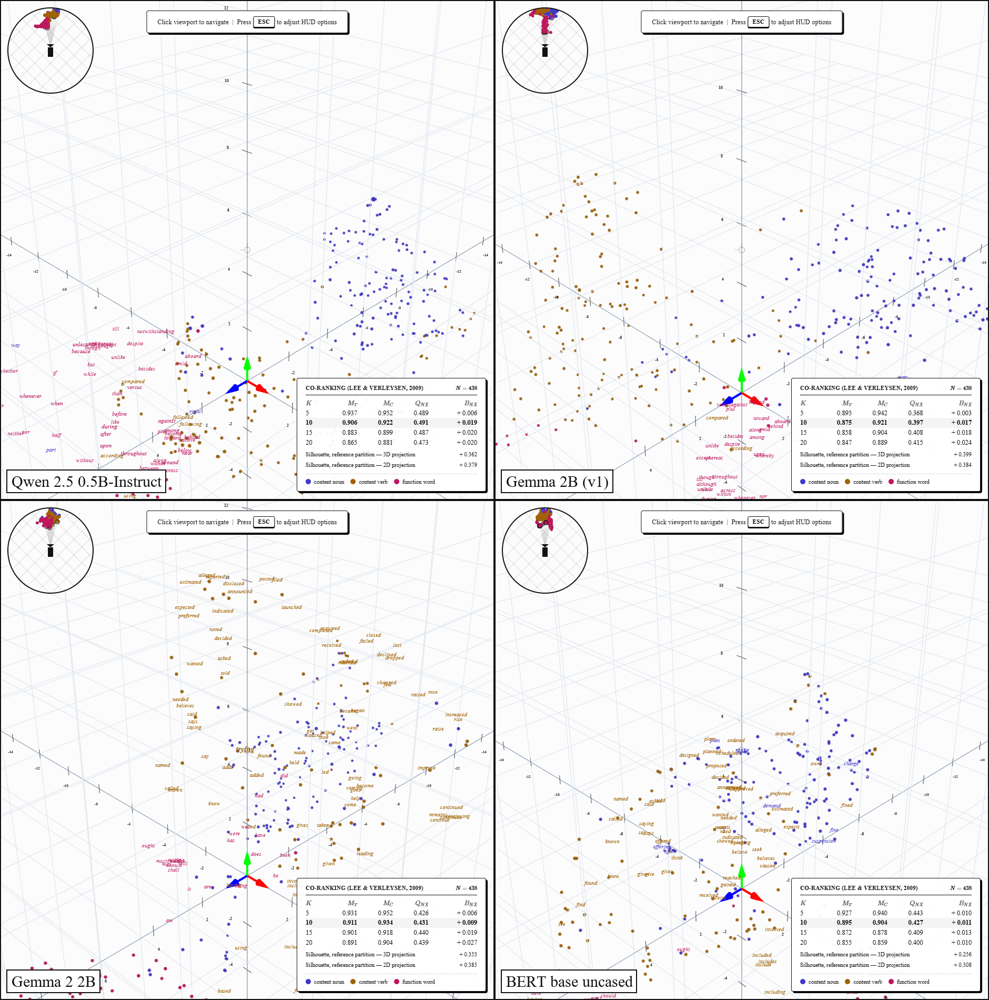
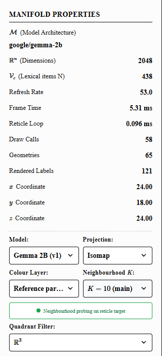
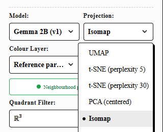
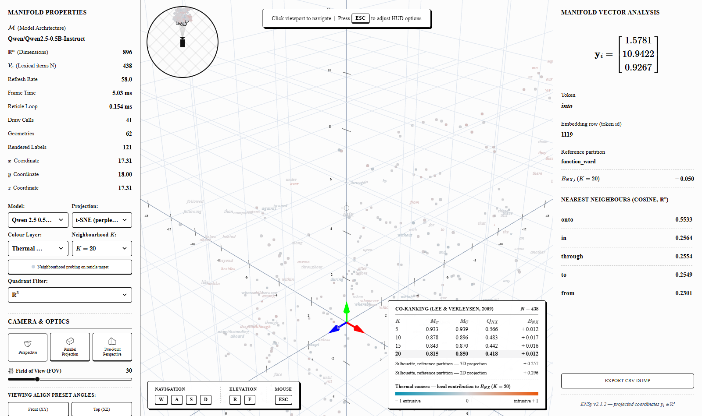

# ENSy: An Interactive Instrument for Measuring How Dimensionality Reduction Distorts the Input-Embedding Geometry of Language Models

**Author:** Alexandre da Silva Santos  
**Institution:** Federal University of Maranhão  
**Program:** B.Sc. in Science and Technology – Computer Engineering  
**Date:** October 2026  
**Version:** 2.1.3 (manuscript for review)

## Abstract

Dimensionality reduction is the usual way to look at the embedding spaces of language models, but every projection to two or three dimensions distorts the neighbourhood structure it is meant to reveal. This work presents **ENSy (Embedding Navigation System)**, a browser-based research instrument that projects the static input-embedding matrices of four pre-trained models — Qwen 2.5 0.5B-Instruct, Gemma 2B (v1), Gemma 2 2B and BERT base uncased — with PCA, t-SNE, UMAP and Isomap, and quantifies the distortion of every projection with the rank-based co-ranking framework of Lee and Verleysen (2009): trustworthiness, continuity, $Q_{NX}(K)$ and the behaviour indicator $B_{NX}(K)$, together with a per-token decomposition $B_{NX,i}(K)$ that drives a "thermal camera" overlay in an interactive 3D viewer. The lexical sample is a frozen, hashed set of $N=438$ English word types derived from the Penn Treebank and balanced across nouns, verbs and function words, restricted to forms that are a single token in all four tokenizers. The implementation is validated against an independent library and synthetic rank permutations, and every reported number is regenerated by a pinned, version-controlled pipeline. Three findings stand out. First, the sign of t-SNE's behaviour indicator is set by the perplexity rather than by the model: with perplexity 5 the projections are mildly intrusive (or neutral), with perplexity 30 they are extrusive in all four models, by a margin far larger than the variation across random seeds. Second, every projection inflates the separation of the linguistic categories: Silhouette scores of 0.025–0.055 in the original spaces rise, in most configurations, to 0.15–0.40 after projection, and further in 2D than in 3D for the non-linear methods. Third, the two Gemma generations, which share the same vocabulary, are not interchangeable: Gemma 2's projections have higher trustworthiness under every algorithm. The results are descriptive; they characterise the instrument and the projections, not causal properties of model architectures.

**Keywords:** word embeddings, dimensionality reduction, co-ranking matrix, trustworthiness, continuity, $B_{NX}$, t-SNE perplexity, UMAP, Isomap, PCA, visual analytics, reproducibility.

---

---columns{count=2}---

## 1. Introduction

The input-embedding matrix of a language model maps each token of its vocabulary to a vector in $\mathbb{R}^d$, with $d$ in the hundreds or thousands. Because such spaces cannot be inspected directly, analyses of their geometry routinely rely on two- or three-dimensional projections. A projection, however, cannot preserve every neighbourhood relation of the original space; points that are far apart may be drawn together (*intrusions*) and genuine neighbours may be pulled apart (*extrusions*). Without measuring these distortions, a reader cannot tell which visual clusters belong to the model and which were created by the projection.

ENSy addresses this gap. It is not the object of study of the thesis but the instrument that produces its evidence: a reproducible pipeline that projects embedding matrices with four standard algorithms and reports, for every projection, how faithfully it preserves $K$-ary neighbourhoods, together with an interactive 3D viewer in which those distortions can be inspected token by token.

The guiding question is: *how do PCA, t-SNE, UMAP and Isomap preserve or distort the neighbourhood structure of the input-embedding spaces of language models?* The contributions are:

1. **A validated co-ranking implementation** — trustworthiness/continuity identical to an independent implementation, the behaviour indicator $B_{NX}(K)$ checked against the primary source and anchored empirically, and an exact per-token decomposition $B_{NX,i}(K)$ (Section 3.6).
2. **A frozen experimental protocol** — a hashed Penn-Treebank-derived lexical dataset, pinned model revisions, a fully explicit parameter table and a continuous-integration run that rebuilds the dataset and reproduces the results (Section 3).
3. **An interactive instrument** — a WebGL viewer with a reference-partition colouring, a thermal camera for $B_{NX,i}(K)$ and neighbourhood probing (Section 4).
4. **Empirical results** for 4 models × 5 projection configurations, a seed/perplexity sensitivity analysis and a PCA centring ablation (Section 5).

## 2. Background

### 2.1 Input embeddings and cosine geometry

ENSy studies exclusively the static input-embedding matrix of each model: the lookup table applied before any contextual layer. This representation is directly comparable across decoder-only and encoder-only architectures, whereas contextual hidden states would require choices of layer, context and pooling that change what is being measured. All vectors are $L_2$-normalised, so that

$$
\|\hat u - \hat v\|^2 = 2\,(1 - \cos\theta),
$$

that is, Euclidean distance on the unit sphere is a monotone function of cosine distance. Normalisation does not remove the anisotropy of embedding spaces (Ethayarajh, 2019; Cai et al., 2021); it only makes cosine and Euclidean neighbourhoods coincide. As a consequence, the neighbour ranks used by every metric below are identical whichever of the two metrics is used in the original space.

### 2.2 Projection algorithms

**PCA** projects onto the directions of maximum variance of the centred data, computed by a singular value decomposition $X_c = U\Sigma V^\top$, $Y = X_c V_{1:3}$ (Pearson, 1901). A non-centred variant (PCA-NC) is used only as an ablation.

**t-SNE** matches neighbour distributions with a Gaussian kernel in the original space and a Student-t kernel in the projection by minimising $\mathrm{KL}(P\,\|\,Q)$ (van der Maaten and Hinton, 2008). Its *perplexity* is "a smooth measure of the effective number of neighbors", with "typical values between 5 and 50" (van der Maaten and Hinton, 2008, p. 2582).

**UMAP** builds a fuzzy neighbourhood graph and optimises a low-dimensional layout by cross-entropy (McInnes et al., 2018); its number of neighbours sets "the local scale at which to approximate the manifold".

**Isomap** estimates geodesic distances as shortest paths in a $k$-nearest-neighbour graph and embeds them with classical MDS (Tenenbaum et al., 2000). Points disconnected from the graph's giant component have no finite geodesic distance; the original authors note they "can be deleted from further analysis" (Tenenbaum et al., 2000, note 19).

### 2.3 The co-ranking framework

Let $\rho_{ij}$ be the rank of $j$ among the neighbours of $i$ in the original space and $r_{ij}$ its rank in the projection (reflexive ranks are 0; ties are broken by index). The co-ranking matrix (Lee and Verleysen, 2009) is the joint histogram of the two ranks,

$$
Q = [q_{kl}]_{1 \le k,l \le N-1},
$$

$$
q_{kl} = \big|\{(i,j) : \rho_{ij}=k \text{ and } r_{ij}=l\}\big|,
$$

with rows indexed by the original rank. For a neighbourhood size $K$, $Q$ splits into the blocks $UL_K$, $UR_K$, $LL_K$, $LR_K$, and $UL_K$ into its diagonal $D_K$ and lower/upper triangles $LT_K$, $UT_K$. *Mild* $K$-intrusions (items promoted inside the neighbourhood) fall in $LT_K$, mild $K$-extrusions (items demoted inside it) in $UT_K$, and *hard* intrusions and extrusions — pairs that cross the $K$ boundary — in $LL_K$ and $UR_K$.

**Trustworthiness and continuity** (Venna and Kaski, 2001) penalise hard intrusions and hard extrusions, weighted by how far they cross the boundary:

$$
M_T(K) = 1 - \frac{2}{G_K}\sum_{(k,l)\in LL_K}(k-K)\,q_{kl},
$$

$$
M_C(K) = 1 - \frac{2}{G_K}\sum_{(k,l)\in UR_K}(l-K)\,q_{kl},
$$

with $G_K = NK(2N-3K-1)$ for $K < N/2$.

**Overall quality and behaviour.** Following Lee and Verleysen (2009, Eq. 22–25),

$$
U_N(K) = \frac{1}{KN}\sum_{LT_K} q_{kl},\qquad U_X(K) = \frac{1}{KN}\sum_{UT_K} q_{kl},
$$

$$
U_P(K) = \frac{1}{KN}\sum_{D_K} q_{kl},\qquad Q_{NX}(K) = U_P + U_N + U_X,
$$

$$
\boxed{B_{NX}(K) = U_X(K) - U_N(K)}.
$$

$Q_{NX}(K)$ is the average fraction of shared $K$-neighbours. $B_{NX}(K)$ is, in the authors' words, "positive for intrusive embeddings and negative for extrusive ones" (Lee and Verleysen, 2009, p. 1434). The sign looks inverted only at first sight: a single hard intrusion pushes every subsequent genuine neighbour one rank down, producing $(K - r_{ij})$ mild extrusions, so the number of mild extrusions measures the severity of the intrusions (ibid., Fig. 2). The same paper defines a second behaviour indicator, $B_{TC}(K) = M_C(K) - M_T(K)$ (Eq. 27), which weights hard events instead of counting mild ones; both are reported.

**Per-token decomposition.** Since $q_{kl} = \sum_i q_{kl}^{(i)}$, applying the same masks to the counts of a single point $i$ gives

$$
B_{NX,i}(K) = \frac{1}{K}\Big(\sum_{UT_K} q_{kl}^{(i)} - \sum_{LT_K} q_{kl}^{(i)}\Big),
$$

$$
B_{NX}(K) = \frac{1}{N}\sum_{i=1}^{N} B_{NX,i}(K),
$$

with $|B_{NX,i}(K)| \le (K-1)/K$. ENSy's thermal camera displays this quantity, which is the token's net contribution to intrusive or extrusive behaviour, not a general "local distortion".

### 2.4 Silhouette

For the reference partition (Section 3.3), the Silhouette $s(i) = \frac{b(i)-a(i)}{\max(a(i),b(i))}$ (Rousseeuw, 1987) measures how well the categories are separated. It is computed in the projected space, in both 3D and 2D, and — as a reference — in the original space with the cosine metric. It measures separation, not its cause.

## 3. Materials and methods

### 3.1 Models

Four pre-trained checkpoints are used, pinned to the Hugging Face revisions recorded in the dataset file:

:::booktabs
| Model | Repository | Type | $d$ | Vocabulary |
|---|---|---|---|---|
| Qwen 2.5 0.5B-Instruct | `Qwen/Qwen2.5-0.5B-Instruct` | decoder | 896 | 151,665 |
| Gemma 2B (v1) | `google/gemma-2b` | decoder | 2,048 | 256,000 |
| Gemma 2 2B | `google/gemma-2-2b` | decoder | 2,304 | 256,000 |
| BERT base uncased | `bert-base-uncased` | encoder | 768 | 30,522 |
:::

Both Gemma generations are included because "Gemma 2B" names two different checkpoints; they share the same tokenizer, so the comparison isolates the change in the embedding matrix. The models differ simultaneously in architecture, dimension, vocabulary, objective, corpus and training recipe; the design allows observing whether distortion patterns hold across models, not attributing them to architecture.

### 3.2 Extraction protocol

For each word $w$, the token looked up is the word-initial surface form — `" " + w` for the byte-level BPE (Qwen) and SentencePiece (Gemma) tokenizers, $w$ for WordPiece (BERT). The distinction matters: in Qwen, `run` and ` run` are different rows (ids 6108 and 1598). A word is included only if, in every tokenizer, it encodes to exactly one id without special tokens, the id is not the unknown or a special token, the id is a valid row of the embedding matrix, and it decodes back to the word.

The selected rows are read directly from the checkpoint's safetensors file with HTTP range requests: only the file header and the required rows are transferred (kilobytes to a few megabytes instead of multi-gigabyte checkpoints). The rows are bit-identical to `model.get_input_embeddings().weight` and to a full download (tested for Qwen and BERT). They are cast to `float32` and $L_2$-normalised.

### 3.3 Lexical dataset derived from the Penn Treebank

The dataset is built from the freely distributed Penn Treebank sample in NLTK (the full treebank is licensed by the LDC). Tokens are lower-cased; non-alphabetic tokens and proper nouns (`NNP/NNPS`) are discarded. Tags map to a *reference linguistic partition*: `NN, NNS` → `content_noun`; `VB*` → `content_verb`, except the auxiliary forms of *be*, *have* and *do*, which count as `function_word`; `DT, PDT, IN, CC, TO, MD, PRP, PRP$, WDT, WP, WP$, WRB, EX, RP` → `function_word`. Two fixed rules remove tokenisation artefacts: clitic stems (`ca`, `wo`, `ai` from `ca n't`) and function-word forms internal to foreign names (`de`, `la`, `le`, `del`). Each form receives its majority category over all its occurrences; ties and forms whose majority lies outside the partition are excluded. After the single-token filter, each category is cut to the size of the smallest one, keeping its most frequent forms.

<!-- BEGIN:dataset -->
:::booktabs
| Stage | Count |
|---|---|
| PTB tokens (NLTK sample) | 100,676 |
| Lexical types (lower-cased, alphabetic, no proper nouns) | 7,295 |
| Excluded artefacts (clitic stems, name-internal forms) | 7 |
| Excluded: category tie / majority outside the partition | 78 / 1,418 |
| After disambiguation | 5,792 |
| Dropped as multi-token (first failing tokenizer) | Qwen 2.5 0.5B 932, Gemma 2B (v1) 4, Gemma 2 2B 0, BERT base 314 |
| Single-token in all four tokenizers: noun / verb / function | 2,684 / 1,712 / 146 |
| **Balanced dataset $N$** | **438** (146 per category) |
:::

*Dataset hash `40863cdefcb4`.*

<!-- END:dataset -->

The function words are the binding category; the final $N$ is reported as obtained, not adjusted to a target. The file `data/dataset.json` records the rules, the model revisions and a SHA-256 hash of the items.

### 3.4 Projection parameters

All parameters were fixed before collection; library defaults are written out so that results do not depend on the installed version's defaults.

:::booktabs
| Algorithm | Parameters |
|---|---|
| PCA | 3 components, centred, full SVD; component sign fixed (largest loading positive) |
| PCA-NC (ablation) | as PCA, without centring |
| t-SNE | perplexity 5 (frozen) **and** 30 (library default); cosine; seed 42; PCA initialisation; learning rate "auto"; 1000 iterations; Barnes–Hut, $\theta=0.5$ |
| UMAP | 15 neighbours, min. distance 0.1 (library defaults); cosine; seed 42 |
| Isomap | 15 neighbours; cosine; giant component of the $k$-NN graph only |
:::

t-SNE is reported at both perplexities because the sensitivity analysis (Section 5.4) shows that the sign of its behaviour indicator depends on this choice. Each configuration is also run with two components to compute the 2D Silhouette.

### 3.5 Evaluation protocol

For each of the 4 × 5 configurations, $M_T$, $M_C$, $Q_{NX}$, $B_{NX}$ and $B_{TC}$ are computed for $K \in \{5, 10, 15, 20\}$ and presented as curves; $K=10$ is the reference value, following the observation that "a human analyst usually looks at a handful (say 10) data points around" a point of interest (Venna and Kaski, 2006, p. 894). Ranks in the original space use the cosine distance; ranks in the projection use the Euclidean distance. Two analyses are kept separate from the main matrix: a **sensitivity analysis** (seeds 0, 1, 2, 3 and 42 for t-SNE at both perplexities and for UMAP) and a **PCA-NC ablation**.

**Reproducibility.** The canonical run is a GitHub Actions workflow on a clean checkout with pinned dependencies (CPU-only PyTorch). It runs the validation suite, rebuilds the dataset and checks that its hash matches the committed one, runs the main matrix, the ablation and the sensitivity analysis, and compares its numbers with the committed results.

### 3.6 Validation of the implementation

Before any result was produced, the metric code was validated by an automated suite:

- $M_T$ and $M_C$ coincide with `sklearn.manifold.trustworthiness` (applied in both directions) to $10^{-12}$ for every $K$;
- every row and column of $Q$ sums to $N$, and hard intrusions equal hard extrusions;
- **synthetic rank permutations**: identity gives $B_{NX}=0$ and $M_T=M_C=Q_{NX}=1$; promoting one item from rank $m$ to rank 1 gives exactly $B_{NX,i} = (m-2)/K > 0$; demoting rank 1 to $m$ gives $-(m-2)/K$; a single swap gives $U_N = U_X = 1/(KN)$;
- **sign anchor**: a sphere crushed by orthographic projection (a textbook intrusive map) yields $B_{TC} > 0$ and $B_{NX} > 0$; a sphere torn open yields both negative;
- the mean of $B_{NX,i}(K)$ equals $B_{NX}(K)$ to $10^{-12}$, and $|B_{NX,i}| \le (K-1)/K$.

## 4. The ENSy instrument

### 4.1 Architecture

A FastAPI server loads the frozen dataset, extracts and caches the normalised rows per model, and serves, for each (model, algorithm) pair, the projected coordinates, the metric curves, $B_{NX,i}(K)$ for every token and $K$, the 20 nearest neighbours of every token in both spaces, and both Silhouette scores. A React/TypeScript client renders the projection with Three.js. No placeholder data is ever displayed: when a projection is being computed the viewer says so, and when data are unavailable it shows the reason.


_Figure 1: The ENSy workspace (Qwen 2.5, UMAP, isometric view). Left: model, projection, colour layer and K selectors, camera optics and live profiling. Centre: the 438 tokens, coloured by the reference partition. Bottom right: the co-ranking curves of the current projection. Right: the inspector for the token under the reticle, with its true, false and missing neighbours._

### 4.2 Faithful rendering

The rendered cloud is the projection itself: coordinates are placed with a single isotropic similarity transform (median centre, one scale for all axes, set by the 99th-percentile radius), which preserves all ratios of distances. All tokens live in one `BufferGeometry` with per-vertex RGBA colour (one draw call for the cloud regardless of $N$). Word labels are the markers; to keep the frame time low, only the 120 labels nearest to the camera are laid out each frame, and tokens whose label is culled are drawn as small dots.

### 4.3 Colour layers and probing

Three layers share the colour channel with a fixed precedence — probing > thermal camera > reference partition — and never mix on one token. The **reference partition** colours nouns, verbs and function words. The **thermal camera** maps $B_{NX,i}(K)$ onto a fixed bipolar scale on $[-1, 1]$ (cyan: extrusive; light grey: neutral; orange: intrusive), never normalised per frame, so equal values always receive equal colours across projections. **Probing** colours, for the token under the reticle, its true ($N_K \cap n_K$, green), false ($n_K \setminus N_K$, red) and missing ($N_K \setminus n_K$, translucent blue) neighbours.



_Figure 2: Thermal camera on Qwen 2.5 with t-SNE (perplexity 5), $K = 10$: each token's local contribution to $B_{NX}(10)$ on the fixed scale $[-1, 1]$._



_Figure 3: Neighbourhood probing after flying towards a token (BERT, UMAP, $K = 10$). Green: genuine neighbours kept by the projection; red: false neighbours introduced by it; translucent blue: genuine neighbours it pushed away._

### 4.4 Navigation and interface

The viewer offers first-person 6-DOF flight (W/A/S/D, R/F, mouse look under pointer lock), perspective, parallel and two-point perspective cameras with LERP/SLERP transitions between front, top, side and isometric presets, an octant filter and a minimap. A central reticle selects the nearest token in screen space within 25 px.

<figure class="academic-figure">
  
  <figcaption><strong class="caption-label">Fig. 4.</strong> Token inspector: projected coordinates, embedding row, reference category, $B_{NX,i}(K)$, the probing lists and the nearest neighbours by cosine similarity in $\mathbb{R}^n$.</figcaption>
</figure>

<figure class="academic-figure">
  
  <figcaption><strong class="caption-label">Fig. 5.</strong> Co-ranking panel for Gemma 2B (v1) with Isomap: $M_T$, $M_C$, $Q_{NX}$ and $B_{NX}$ over $K$, and the 3D and 2D Silhouette scores.</figcaption>
</figure>

---/columns---

## 5. Results

### 5.1 Dataset

The pipeline yields $N = 438$ word types (146 per category); the function words are the binding category. In the table, each multi-token rejection is attributed to the first tokenizer that rejected it, in the order Qwen, Gemma 1, Gemma 2, BERT; Gemma 2 rejected nothing that Gemma 1 had accepted, as expected from their shared vocabulary.

### 5.2 Neighbourhood preservation

<!-- BEGIN:main -->
:::booktabs[wide]
| Model | Algorithm | $M_T$ | $M_C$ | $Q_{NX}$ | $B_{NX}$ | $B_{TC}$ | $s_{3D}$ | $s_{2D}$ |
|---|---|---|---|---|---|---|---|---|
| Qwen 2.5 0.5B | PCA | 0.830 | 0.828 | 0.205 | −0.007 | −0.001 | +0.161 | +0.081 |
| Qwen 2.5 0.5B | t-SNE ($p=5$) | 0.878 | 0.896 | 0.483 | +0.017 | +0.018 | +0.257 | +0.296 |
| Qwen 2.5 0.5B | t-SNE ($p=30$) | 0.887 | 0.901 | 0.481 | −0.032 | +0.014 | +0.208 | +0.307 |
| Qwen 2.5 0.5B | UMAP | 0.906 | 0.922 | 0.491 | +0.019 | +0.016 | +0.362 | +0.379 |
| Qwen 2.5 0.5B | Isomap | 0.792 | 0.910 | 0.248 | +0.028 | +0.117 | +0.281 | +0.341 |
| Gemma 2B (v1) | PCA | 0.847 | 0.875 | 0.222 | +0.002 | +0.028 | +0.307 | +0.369 |
| Gemma 2B (v1) | t-SNE ($p=5$) | 0.840 | 0.821 | 0.376 | +0.005 | −0.019 | +0.246 | +0.320 |
| Gemma 2B (v1) | t-SNE ($p=30$) | 0.854 | 0.874 | 0.386 | −0.042 | +0.021 | +0.212 | +0.358 |
| Gemma 2B (v1) | UMAP | 0.875 | 0.921 | 0.397 | +0.017 | +0.046 | +0.399 | +0.384 |
| Gemma 2B (v1) | Isomap | 0.816 | 0.885 | 0.207 | −0.001 | +0.069 | +0.279 | +0.295 |
| Gemma 2 2B | PCA | 0.867 | 0.802 | 0.189 | −0.010 | −0.065 | +0.240 | +0.157 |
| Gemma 2 2B | t-SNE ($p=5$) | 0.880 | 0.906 | 0.434 | +0.022 | +0.026 | +0.247 | +0.282 |
| Gemma 2 2B | t-SNE ($p=30$) | 0.891 | 0.879 | 0.415 | −0.054 | −0.011 | +0.233 | +0.270 |
| Gemma 2 2B | UMAP | 0.911 | 0.934 | 0.431 | +0.009 | +0.022 | +0.353 | +0.385 |
| Gemma 2 2B | Isomap | 0.864 | 0.920 | 0.238 | +0.012 | +0.057 | +0.298 | +0.336 |
| BERT base | PCA | 0.819 | 0.810 | 0.182 | −0.005 | −0.008 | +0.159 | +0.089 |
| BERT base | t-SNE ($p=5$) | 0.877 | 0.856 | 0.427 | −0.002 | −0.022 | +0.199 | +0.262 |
| BERT base | t-SNE ($p=30$) | 0.873 | 0.845 | 0.411 | −0.034 | −0.028 | +0.196 | +0.231 |
| BERT base | UMAP | 0.895 | 0.904 | 0.427 | +0.011 | +0.009 | +0.256 | +0.308 |
| BERT base | Isomap | 0.794 | 0.860 | 0.201 | +0.012 | +0.066 | +0.166 | +0.056 |
:::

*Source: `results/main_40863cdefcb4.json` — commit `b8ed448f` (clean working tree), Python 3.12.10, scikit-learn 1.6.1, umap-learn 0.5.7, seed 42, extraction: HTTP Range rows.*

<!-- END:main -->

$s_{3D}$, $s_{2D}$: Silhouette of the reference partition in the 3D and 2D projections. For reference, the Silhouette in the original space and the variance captured by three principal components:

<!-- BEGIN:highdim -->
:::booktabs
| Model | $d$ | $s$ in $\mathbb{R}^d$ (cosine) | PCA variance, 3 components |
|---|---|---|---|
| Qwen 2.5 0.5B | 896 | +0.031 | 7.8% |
| Gemma 2B (v1) | 2048 | +0.055 | 12.6% |
| Gemma 2 2B | 2304 | +0.044 | 10.9% |
| BERT base | 768 | +0.025 | 11.0% |
:::

<!-- END:highdim -->


<!-- BEGIN:curves_mt -->


_Figure 6: Trustworthiness $M_T(K)$ over $K$ for every model and projection configuration._

<!-- END:curves_mt -->


<!-- BEGIN:curves_bnx -->


_Figure 7: Behaviour indicator $B_{NX}(K)$ over $K$ (positive: intrusive; negative: extrusive). With perplexity 30, t-SNE is below zero at every $K$ in all four models; with perplexity 5 it is positive for Qwen and Gemma 2, positive for Gemma 1 except at $K=5$, and close to zero for BERT._

<!-- END:curves_bnx -->

### 5.3 Visual comparison



_Figure 8: The five projection configurations of Gemma 2 2B seen from the same camera (isometric preset, then the same short forward flight), coloured by the reference partition (indigo: nouns; ochre: verbs; magenta: function words). The semi-opaque plane backgrounds are switched off so that tokens behind the coordinate planes stay visible._



_Figure 9: UMAP projections of the four models from the same camera and parameters (plane backgrounds off)._

### 5.4 Sensitivity to seed and perplexity

<!-- BEGIN:sensitivity -->
:::booktabs[wide]
| Model | Configuration | $M_T(10)$ | $B_{NX}(10)$ | $s_{3D}$ | $s_{2D}$ |
|---|---|---|---|---|---|
| Qwen 2.5 0.5B | t-SNE $p=5$ | 0.880 ± 0.003 | +0.014 ± 0.002 | +0.250 ± 0.006 | +0.293 ± 0.005 |
| Qwen 2.5 0.5B | t-SNE $p=30$ | 0.892 ± 0.006 | −0.036 ± 0.005 | +0.189 ± 0.017 | +0.297 ± 0.014 |
| Qwen 2.5 0.5B | UMAP | 0.903 ± 0.003 | +0.019 ± 0.006 | +0.363 ± 0.008 | +0.378 ± 0.005 |
| Gemma 2B (v1) | t-SNE $p=5$ | 0.845 ± 0.004 | +0.012 ± 0.005 | +0.260 ± 0.017 | +0.320 ± 0.004 |
| Gemma 2B (v1) | t-SNE $p=30$ | 0.849 ± 0.007 | −0.036 ± 0.005 | +0.194 ± 0.018 | +0.348 ± 0.018 |
| Gemma 2B (v1) | UMAP | 0.874 ± 0.002 | +0.014 ± 0.003 | +0.393 ± 0.010 | +0.394 ± 0.014 |
| Gemma 2 2B | t-SNE $p=5$ | 0.882 ± 0.002 | +0.020 ± 0.006 | +0.235 ± 0.033 | +0.289 ± 0.006 |
| Gemma 2 2B | t-SNE $p=30$ | 0.893 ± 0.002 | −0.047 ± 0.007 | +0.224 ± 0.007 | +0.312 ± 0.027 |
| Gemma 2 2B | UMAP | 0.914 ± 0.002 | +0.009 ± 0.009 | +0.356 ± 0.002 | +0.376 ± 0.011 |
| BERT base | t-SNE $p=5$ | 0.877 ± 0.002 | −0.001 ± 0.002 | +0.204 ± 0.005 | +0.260 ± 0.009 |
| BERT base | t-SNE $p=30$ | 0.872 ± 0.002 | −0.039 ± 0.004 | +0.173 ± 0.016 | +0.174 ± 0.068 |
| BERT base | UMAP | 0.892 ± 0.003 | +0.018 ± 0.007 | +0.254 ± 0.007 | +0.301 ± 0.014 |
:::

*Mean ± sample standard deviation over seeds {0, 1, 2, 3, 42}.* *Source: `results/sensitivity_40863cdefcb4.json` — commit `b8ed448f` (modified working tree), Python 3.12.10, scikit-learn 1.6.1, umap-learn 0.5.7, seed 42, extraction: HTTP Range rows.*

<!-- END:sensitivity -->

### 5.5 Ablation: PCA without centring

<!-- BEGIN:ablation -->
:::booktabs
| Model | PCA $M_T$ / $M_C$ | PCA-NC $M_T$ / $M_C$ | PCA-NC $B_{NX}$ |
|---|---|---|---|
| Qwen 2.5 0.5B | 0.830 / 0.828 | 0.793 / 0.794 | +0.000 |
| Gemma 2B (v1) | 0.847 / 0.875 | 0.771 / 0.829 | +0.002 |
| Gemma 2 2B | 0.867 / 0.802 | 0.843 / 0.762 | −0.008 |
| BERT base | 0.819 / 0.810 | 0.778 / 0.746 | −0.009 |
:::

<!-- END:ablation -->

---columns{count=2}---

## 6. Discussion

**The perplexity decides the sign of t-SNE's behaviour.** With the frozen perplexity of 5, t-SNE is mildly intrusive in three models and neutral in BERT; with perplexity 30 it is extrusive in all four, and the gap is many times larger than the spread across five seeds (Section 5.4). A statement such as "t-SNE tears the embedding space" is therefore a statement about a hyperparameter as much as about the algorithm. Both values lie in the range recommended by the method's authors, so neither can be dismissed; the defensible report is the pair. Low perplexity also showed a numerical artefact: with perplexity 5 a single word was occasionally ejected far from the cloud, a different one depending on the seed, although the word was not isolated in the original space.

**Projections manufacture category separation.** In the original spaces the reference categories are barely separated (Silhouette 0.025–0.055), while every projection raises the score above its original-space value, in most configurations to 0.15–0.40. The dimension of the display matters too: for the non-linear methods the 2D Silhouette exceeds the 3D one in 14 of 16 configurations, whereas for PCA it is lower in three of the four models. A visually clean separation of nouns, verbs and function words in a projection is thus weak evidence about the embedding space itself; the co-ranking metrics are the appropriate check, and Silhouette values from 2D and 3D displays should not be compared directly.

**Neighbourhood preservation depends on the algorithm.** UMAP reaches the highest trustworthiness in every model. Isomap has the lowest trustworthiness — below even PCA, whose three components capture only 8–13% of the variance — but continuity well above it in every model, which $B_{TC}$ reports as clearly intrusive ($+0.057$ to $+0.117$).

**Two generations of the same model differ.** Gemma 2B (v1) and Gemma 2 2B share their vocabulary, so the 438 words map to the same token ids, yet the projections of Gemma 2 preserve neighbourhoods better under every algorithm, while Gemma 1 keeps more continuity under PCA. Model "identity" in such studies must therefore be specified down to the checkpoint.

**Two behaviour indicators, two views.** $B_{NX}$ counts mild events only; $B_{TC}$ weights hard events by their rank error. They can disagree: with perplexity 30, $B_{NX}$ is negative for t-SNE in all four models, while $B_{TC}$ is positive for Qwen and Gemma 1 and negative for Gemma 2 and BERT. Reporting both avoids over-reading either.

### 6.1 Limitations

**Static embeddings only.** Contextual hidden states are deliberately out of scope (Section 2.1).
**No causal attribution.** The models differ in many factors at once.
**Sample.** The dataset comes from the NLTK sample of the Penn Treebank and is limited by the 146 function words that are single tokens in all tokenizers; the results describe these 438 frequent English word types.
**Descriptive statistics.** The main matrix uses one seed per configuration; variability is reported by the sensitivity analysis, and no hypothesis tests are performed.
**Provenance.** The main matrix was produced from a clean checkout of the recorded commit; the ablation and sensitivity files were produced from the same commit while documentation files were being edited, so they record a modified working tree. The continuous-integration run is the canonical, clean record of all three.
**Single-tokenisation bias.** Restricting to single-token words favours frequent, short words, whose embeddings are typically better trained.

## 7. Conclusion

ENSy turns the projection of an embedding matrix from a picture into a measurement. Its co-ranking implementation is validated against an independent library, synthetic permutations and the primary source, and its results are regenerated from a frozen dataset by a pinned pipeline. Applied to four language models, it shows that the visual impressions most often drawn from such projections — whether a method crowds or tears the space, and whether linguistic categories form clusters — depend strongly on the projection and its hyperparameters. Projections of embedding spaces should therefore be reported with their neighbourhood-preservation metrics and their hyperparameters, never alone. Natural extensions are contextual representations, larger and multilingual samples, and inferential statistics over seeds and samples.

---/columns---

:::pagebreak

## Appendix A: Reproducing the results

```bash
pip install -r requirements.txt          # pinned versions
export HF_TOKEN=...                       # licence accepted for both Gemma repositories
python -m ensy.dataset                    # rebuild data/dataset.json (hash must match)
python -m ensy.experiment                 # main matrix   -> results/main_<hash>.json
python -m ensy.experiment --ablation      # PCA-NC        -> results/ablation_<hash>.json
python -m ensy.experiment --sensitivity   # seeds/perplexity -> results/sensitivity_<hash>.json
python -m ensy.compare results/main_<hash>.json other/main_<hash>.json --markdown
python docs/update_results.py             # regenerate the tables and plots of Section 5
python docs/capture_screenshots.py        # regenerate the figures (server running)
python docs/md_to_pdf.py                  # build this PDF
```

## Appendix B: Interface figures

<figure class="academic-figure">
  
  <figcaption><strong class="caption-label">Fig. 10.</strong> Left sidebar: manifold properties, profiling, and the experiment selectors.</figcaption>
</figure>

<figure class="academic-figure">
  
  <figcaption><strong class="caption-label">Fig. 11.</strong> The projection selector, listing both t-SNE perplexities and the PCA-NC ablation.</figcaption>
</figure>



_Figure 12: Thermal camera for the same projection as Figure 2 at $K = 20$._


_Figure 13: Front (XY) camera preset on the PCA projection of Qwen 2.5._


_Figure 14: Top (XZ) camera preset on the PCA projection of Qwen 2.5._

## Appendix C: API

:::booktabs
| Endpoint | Description |
|---|---|
| `GET /api/health` | dataset path, $N$, frozen flag |
| `GET /api/models` | models, gating, whether the dataset covers them |
| `GET /api/dataset` | dataset metadata and items |
| `POST /api/dataset` | rebuild the dataset (refuses to overwrite a frozen one without `force`) |
| `GET /api/projection/{model}/{algorithm}` | coordinates, metric curves, $B_{NX,i}(K)$, neighbour lists, Silhouette (3D, 2D) |
| `GET /api/compare` | metric curves of every configuration of the main matrix |
:::

`model` ∈ {`qwen`, `gemma`, `gemma2`, `bert`}; `algorithm` ∈ {`pca`, `pca_nc`, `tsne`, `tsne_p30`, `umap`, `isomap`}.

## Appendix D: Keyboard controls

:::booktabs
| Input | Action |
|---|---|
| Click viewport | engage pointer lock (flight mode) |
| W / S | move forward / backward in the horizontal plane |
| A / D | strafe left / right |
| R / F | move up / down |
| Mouse | look (pitch clamped) |
| Wheel | zoom |
| H | toggle the navigation HUD |
| Esc | release pointer lock |
:::

---

## References

CAI, Xingyu et al. Isotropy in the contextual embedding space: clusters and manifolds. In: **International Conference on Learning Representations (ICLR)**, 2021.

CHEN, Lisha; BUJA, Andreas. Local multidimensional scaling for nonlinear dimension reduction, graph drawing, and proximity analysis. **Journal of the American Statistical Association**, v. 104, n. 485, p. 209–219, 2009.

ETHAYARAJH, Kawin. How contextual are contextualized word representations? Comparing the geometry of BERT, ELMo, and GPT-2 embeddings. In: **EMNLP-IJCNLP**, 2019, p. 55–65.

LEE, John A.; VERLEYSEN, Michel. Quality assessment of dimensionality reduction: rank-based criteria. **Neurocomputing**, v. 72, n. 7–9, p. 1431–1443, 2009.

MCINNES, Leland; HEALY, John; MELVILLE, James. UMAP: uniform manifold approximation and projection for dimension reduction. **arXiv:1802.03426**, 2018.

PEARSON, Karl. On lines and planes of closest fit to systems of points in space. **Philosophical Magazine**, v. 2, n. 11, p. 559–572, 1901.

ROUSSEEUW, Peter J. Silhouettes: a graphical aid to the interpretation and validation of cluster analysis. **Journal of Computational and Applied Mathematics**, v. 20, p. 53–65, 1987.

TENENBAUM, Joshua B.; DE SILVA, Vin; LANGFORD, John C. A global geometric framework for nonlinear dimensionality reduction. **Science**, v. 290, n. 5500, p. 2319–2323, 2000.

VAN DER MAATEN, Laurens; HINTON, Geoffrey. Visualizing data using t-SNE. **Journal of Machine Learning Research**, v. 9, p. 2579–2605, 2008.

VENNA, Jarkko; KASKI, Samuel. Neighborhood preservation in nonlinear projection methods: an experimental study. In: **ICANN 2001**, LNCS 2130, p. 485–491, 2001.

VENNA, Jarkko; KASKI, Samuel. Local multidimensional scaling. **Neural Networks**, v. 19, n. 6–7, p. 889–899, 2006.
