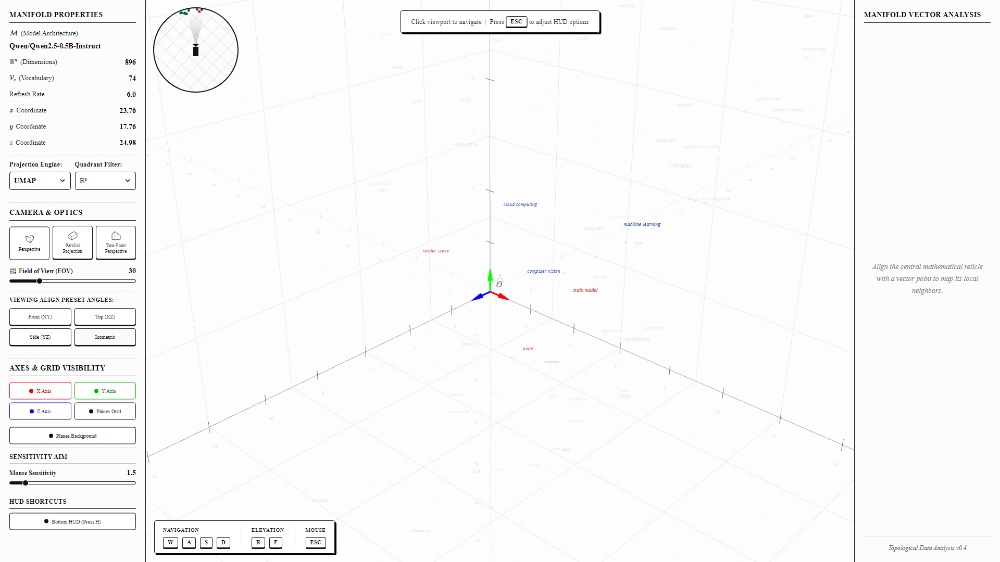

# Semantic Manifold Vector Visualizer: Design, Implementation, and Application of an Interactive Three-Dimensional Tool for the Exploration of Neural Language Model Embedding Spaces

**Authors:** Alexandre Santos  
**Institution:** Federal University of Maranhão  
**Program:** B.Sc. in Science and Technology – Computer Engineering  
**Date:** August 2026    
**Version:** 1.0.0

## Abstract

The internal representations of neural language models, commonly referred to as word embeddings, encode rich semantic and syntactic relationships in high-dimensional vector spaces that resist straightforward human interpretation. This work presents the **Semantic Manifold Vector Visualizer (SMVV)**, an interactive, browser-based computational environment designed to bridge the gap between opaque high-dimensional latent spaces and human geometric intuition. The system integrates a Python-based backend, built with FastAPI and Uvicorn, with a TypeScript and React frontend rendered using the Three.js WebGL engine. Four dimensionality reduction algorithms—UMAP, t-SNE, PCA, and Isomap—project embedding vectors extracted from the Qwen 2.5 0.5B-Instruct language model onto a navigable three-dimensional Cartesian manifold. A central-reticle screen-space raycasting mechanism enables the user to select individual token representations and inspect their five nearest topological neighbors by cosine similarity. Results can be exported as comma-separated value files for downstream statistical analysis. This document provides a comprehensive technical description of the system's architecture, algorithmic foundations, implementation choices, data flow, and user interaction model.

**Keywords:** word embeddings, dimensionality reduction, vector space visualization, UMAP, t-SNE, PCA, Isomap, cosine similarity, Three.js, FastAPI, Qwen 2.5, interpretability.

---

## 1. Introduction

Modern neural language models (NLMs) rely on embedding matrices to map discrete tokens—linguistic units such as words, subwords, or characters—into continuous, dense vectors in a high-dimensional real-valued space $\mathbb{R}^d$. These embedding vectors serve as the primary substrate through which NLMs encode semantic similarity, syntactic relations, and contextual meaning. The geometric structure of these spaces is not arbitrary: tokens with related meanings tend to occupy proximal regions, forming clusters, sub-manifolds, and directional orientations that encode analogical relationships, such as:

$$
\vec{v}_{\text{king}} - \vec{v}_{\text{man}} + \vec{v}_{\text{woman}} \approx \vec{v}_{\text{queen}}
$$

Despite the theoretical richness of these spaces, their high dimensionality—ranging from $128$ to $4096$ dimensions in contemporary models—makes them inherently opaque to direct human inspection. Researchers analyzing model behavior for the purposes of interpretability, bias detection, or curriculum learning must rely on mathematical abstractions and indirect proxies. This opacity represents a significant bottleneck in the field of explainable artificial intelligence (XAI), where understanding the internal geometry of a model is prerequisite to understanding its behavior.

Dimensionality reduction techniques such as Principal Component Analysis (PCA), t-distributed Stochastic Neighbor Embedding (t-SNE), Uniform Manifold Approximation and Projection (UMAP), and Isomap offer a bridge between the native high-dimensional space and lower-dimensional projections that preserve topological or statistical structure to varying degrees. However, existing tools for applying these techniques to language model embeddings are often limited to static 2D scatter plots, require specialized data science environments, or lack interactive inspection capabilities.

This work addresses these limitations by presenting the **Semantic Manifold Vector Visualizer (SMVV)**: a full-stack, interactive application that renders the embedding space of the Qwen 2.5 0.5B-Instruct model as a navigable three-dimensional manifold in the browser. The system enables researchers to:

1. Explore the geometric structure of token embeddings in real-time through first-person flight navigation;
2. Select individual token nodes using a screen-space reticle mechanism and inspect their five nearest neighbors by cosine similarity;
3. Switch between four projection algorithms (UMAP, t-SNE, PCA, Isomap) and observe the resulting structural differences;
4. Export local topological neighborhoods as CSV files for reproducible analysis.


_Figure 1: Complete 1920×1080 workspace in Isometric viewing alignment, illustrating the Left Control Dashboard, central Three.js 3D Manifold Canvas with central crosshair reticle targeting a semantic token, and the populated Right Vector Inspector._

The contribution of this work is both theoretical and practical: it provides a concrete implementation of an XAI instrument for language model geometry, demonstrates the architectural patterns required to couple a machine learning inference pipeline with a real-time 3D rendering engine, and offers an accessible platform for pedagogical exploration of embedding spaces at the undergraduate and graduate levels.

### 1.1 Research Objectives

The primary objectives of this work are:

- **O1:** To design and implement a full-stack interactive system capable of rendering language model embeddings as a navigable 3D manifold;
- **O2:** To integrate four dimensionality reduction algorithms through a unified REST API, allowing algorithmic comparison within a single visual context;
- **O3:** To implement a proximity-based token selection mechanism that exposes topological neighborhood structure through cosine similarity;
- **O4:** To demonstrate the system's utility as an interpretability and pedagogical tool for exploring embedding geometry.

### 1.2 Document Organization

This document is organized as follows. Section 2 provides the theoretical background on word embeddings, dimensionality reduction algorithms, and the cosine similarity metric. Section 3 describes the system architecture in full, encompassing the technology stack, component model, and data flow. Section 4 details the backend implementation, including the embedding pipeline and projection endpoints. Section 5 describes the frontend implementation, with emphasis on the Three.js rendering engine, camera control model, and raycasting selection mechanism. Section 6 discusses user interaction design and interface layout. Section 7 presents the data model and static fallback mechanism. Section 8 discusses limitations and directions for future work. Section 9 concludes.

---

## 2. Theoretical Background

### 2.1 Word Embeddings and the Distributional Hypothesis

The mathematical foundation of word embeddings rests on the **distributional hypothesis**, which asserts that words appearing in similar linguistic contexts tend to share semantic properties. Formally, given a vocabulary $\mathcal{V}$ of $|\mathcal{V}|$ tokens, an embedding model defines a mapping:

$$
f: \mathcal{V} \to \mathbb{R}^d
$$

mapping each token $w_i \in \mathcal{V}$ to a dense vector $\vec{v}_i \in \mathbb{R}^d$, where $d \ll |\mathcal{V}|$. In the specific case of autoregressive transformer models such as Qwen 2.5, this mapping is implemented through a **token embedding matrix** $E \in \mathbb{R}^{|\mathcal{V}| \times d}$, where each row $E_i$ constitutes the input embedding for token $i$. For Qwen 2.5 0.5B-Instruct, the embedding dimensionality is $d = 896$ and the vocabulary size is $|\mathcal{V}| = 151{,}936$.

### 2.2 Cosine Similarity

The **cosine similarity** between two embedding vectors $\vec{u}, \vec{v} \in \mathbb{R}^d$ is defined as:

$$
\text{sim}_{\cos}(\vec{u}, \vec{v}) = \frac{\vec{u} \cdot \vec{v}}{\|\vec{u}\| \|\vec{v}\|} = \frac{\sum_{k=1}^{d} u_k v_k}{\sqrt{\sum_{k=1}^{d} u_k^2} \sqrt{\sum_{k=1}^{d} v_k^2}}
$$

The cosine similarity ranges in the interval $[-1, 1]$, where a value of $+1$ indicates identical orientation, $0$ indicates orthogonality, and $-1$ indicates opposite orientation. This metric is particularly well-suited for embedding spaces because it is invariant to vector magnitude, focusing exclusively on the angular relationship between vectors. This invariance is crucial because embedding models often produce vectors of varying norms that do not encode semantic information.

In the SMVV, cosine similarity is computed for all pairs of tokens using scikit-learn's `cosine_similarity` function on the embedding matrix, yielding a similarity matrix $S \in \mathbb{R}^{N \times N}$ where $N$ is the number of active tokens. The five tokens with the highest similarity scores relative to any given query token constitute its **topological neighborhood**.

### 2.3 Dimensionality Reduction

Since the native embedding dimension $d = 896$ cannot be directly visualized, dimensionality reduction is required. The SMVV implements four distinct algorithms, each offering different preservation guarantees and structural emphases.

#### 2.3.1 Principal Component Analysis (PCA)

PCA is a classical linear method that projects data onto a lower-dimensional subspace defined by the directions of maximum variance in the original data. Given a centered data matrix $X \in \mathbb{R}^{N \times d}$, PCA computes the eigendecomposition of the covariance matrix:

$$
C = \frac{1}{N} X^\top X
$$

selecting the $k$ eigenvectors corresponding to the $k$ largest eigenvalues as the projection axes. PCA is **globally structure-preserving**: the first principal component captures the maximum variance, and subsequent components capture progressively less variance. However, PCA is a linear transformation and cannot capture nonlinear manifold structure that many high-dimensional datasets exhibit.

In the SMVV, PCA is applied independently for 2D and 3D projections using scikit-learn's `PCA(n_components=k, random_state=42)`.


_Figure 2: Linear Principal Component Analysis (PCA) 3D projection of the 896-dimensional embedding space in Isometric perspective._

#### 2.3.2 t-Distributed Stochastic Neighbor Embedding (t-SNE)

t-SNE is a nonlinear probabilistic method that preserves **local neighborhood structure** in the projection. t-SNE constructs a probability distribution $P$ over pairs of points in the high-dimensional space, where the probability $p_{ij}$ reflects how likely points $i$ and $j$ are to be neighbors under a Gaussian kernel. In the low-dimensional space, a similar distribution $Q$ is defined using a Student's t-distribution with one degree of freedom. The projection is optimized by minimizing the Kullback-Leibler divergence between $P$ and $Q$:

$$
\mathcal{L}_{\text{t-SNE}} = \text{KL}(P \parallel Q) = \sum_{i \neq j} p_{ij} \log \frac{p_{ij}}{q_{ij}}
$$

The **perplexity** hyperparameter controls the effective number of neighbors considered. In the SMVV backend, perplexity is dynamically adapted to the token count as:

$$
\text{perplexity} = \min\left(5, \max\left(2, \left\lfloor \frac{N}{4} \right\rfloor\right)\right)
$$

to prevent instability with small datasets. A key limitation of t-SNE is that it does not preserve global distances: cluster separations in the t-SNE projection are not directly interpretable.


_Figure 3: Non-linear t-SNE 3D projection highlighting localized cluster segregation._

#### 2.3.3 Uniform Manifold Approximation and Projection (UMAP)

UMAP is a manifold learning technique grounded in Riemannian geometry and algebraic topology. UMAP constructs a weighted graph representation of the high-dimensional data, approximating the manifold on which the data lies, then optimizes a low-dimensional layout by minimizing the cross-entropy between the high- and low-dimensional fuzzy topological representations. UMAP preserves both **local and global structure** better than t-SNE and is significantly faster for large datasets.

The SMVV applies UMAP with the following configuration:

$$
\text{UMAP}(n\_\text{components}=k,\; n\_\text{neighbors}=\min(4, N-1),\; \text{min\_dist}=0.5,\; \text{metric}=\text{"cosine"},\; \text{random\_state}=42)
$$

The `cosine` metric is specified explicitly, ensuring that UMAP's neighborhood graph is constructed using angular distances consistent with the semantic similarity metric used throughout the system.


_Figure 4: Default UMAP 3D manifold projection constructed using angular cosine metric._

#### 2.3.4 Isomap

Isomap is a nonlinear method that extends classical multidimensional scaling (MDS) to preserve **geodesic distances** on the data manifold. Isomap first constructs a neighborhood graph with $k$ nearest neighbors, then estimates geodesic distances as shortest path lengths in this graph using Dijkstra's algorithm. Finally, classical MDS is applied to the geodesic distance matrix to produce the low-dimensional embedding. Isomap is particularly effective for data lying on a smoothly curved low-dimensional manifold.

In the SMVV, Isomap uses $n\_\text{neighbors} = \min(5, N-1)$ and the `cosine` metric for graph construction.


_Figure 5: Non-linear Isomap 3D projection preserving geodesic neighborhood graph distances._

### 2.4 The Semantic Manifold

The term "manifold" in the SMVV's nomenclature refers to the mathematical concept of a topological manifold: a space that locally resembles Euclidean space but may have complex global topology. The embedding vectors of a language model are hypothesized to lie near a low-dimensional manifold embedded in the high-dimensional vector space $\mathbb{R}^{896}$. The dimensionality reduction algorithms described above are manifestations of the **manifold hypothesis**: the assumption that high-dimensional data of natural origin concentrates near a low-dimensional manifold, and that this manifold structure encodes meaningful relationships.

---

## 3. System Architecture

The SMVV follows a two-tier client-server architecture, separating the computationally intensive embedding extraction and dimensionality reduction from the interactive rendering and user interface.

### 3.1 Technology Stack

| Layer                    | Technology             | Version        | Role                                            |
| ------------------------ | ---------------------- | -------------- | ----------------------------------------------- |
| Frontend framework       | React                  | 19.0.1         | Component-based UI and state management         |
| Type system              | TypeScript             | ~5.8.2         | Static typing across all frontend modules       |
| 3D rendering engine      | Three.js               | 0.184.0        | WebGL-based 3D scene graph and renderer         |
| Build tool               | Vite                   | 6.2.3          | Development server, HMR, and production bundler |
| CSS framework            | Tailwind CSS           | 4.1.14         | Utility-first responsive styling                |
| Mathematical typography  | MathJax                | 3 (CDN)        | LaTeX equation rendering in the browser         |
| Icon library             | Lucide React           | 0.546.0        | UI icons for controls                           |
| Animation library        | Motion                 | 12.23.24       | UI micro-animations                             |
| Backend framework        | FastAPI                | 0.115.8        | Asynchronous REST API server                    |
| ASGI server              | Uvicorn                | 0.34.0         | Production-grade ASGI runner                    |
| Embeddings model         | Qwen 2.5-0.5B-Instruct | —              | Source of token embedding vectors               |
| ML inference             | PyTorch + Transformers | 2.6.0 / 4.49.0 | Tensor operations and model loading             |
| Dimensionality reduction | scikit-learn + UMAP    | 1.6.1 / 0.5.7  | PCA, t-SNE, Isomap, UMAP implementations        |
| Numerical computation    | NumPy                  | 2.1.3          | Vector arithmetic and normalization             |
| Testing framework        | Pytest + Playwright    | 8.3.5 / 1.48.0 | API validation and automated UI screenshots     |

### 3.2 Data Flow

The system's data flow proceeds through the following stages:

**Stage 1 — Application Initialization.** Upon server startup (`app.py`), the dependency installer verifies and installs missing Python packages. The bootstrap vector set ($36 \text{ tokens} \times 896 \text{ dimensions}$) is generated using a seeded pseudo-random normal distribution and normalized to unit length. A daemon thread is immediately launched to load the Qwen 2.5 model in the background.

**Stage 2 — Model Loading (Background).** The background thread loads the Qwen 2.5 tokenizer and model via the HuggingFace Transformers library. The full embedding matrix $E \in \mathbb{R}^{151936 \times 896}$ is extracted from `model.get_input_embeddings().weight`. Each target word is validated: words that tokenize to multiple subword tokens are excluded from the active set (denoted as `dropped_tokens`). Upon successful loading, the global `active_vectors` and `active_words` pointers are atomically updated.

**Stage 3 — API Request.** The React frontend issues an HTTP GET request to `/api/projection/{engine_type}` whenever the user changes the projection algorithm. The Vite development server proxies this request to the FastAPI backend at `http://127.0.0.1:3000`.

**Stage 4 — Projection and Similarity Computation.** The backend applies the requested dimensionality reduction algorithm to `active_vectors`, producing 2D coordinates ($x_{\text{2d}}, y_{\text{2d}}$) and 3D coordinates ($x_{\text{3d}}, y_{\text{3d}}, z_{\text{3d}}$) for each token. It then computes the $N \times N$ cosine similarity matrix and extracts the top-5 neighbors for each token.

**Stage 5 — JSON Response.** The backend returns a JSON object conforming to the `SemanticSpace` interface. The frontend's `App.tsx` stores this in the `semanticSpace` state variable.

**Stage 6 — 3D Scene Update.** `SpaceVisualizer` detects the updated data and calls `syncProjectionDataPrivate()`, which linearly interpolates each token's 3D point towards its new projected position over subsequent animation frames.

**Stage 7 — Offline Fallback.** If the API request fails, `App.tsx` catches the exception and loads the static `semanticSpaceData` from `src/data/semanticSpace.ts`, ensuring the application remains fully functional at all times.

---

## 4. Backend Implementation

### 4.1 Server Entrypoint and Dependency Management

The backend server (`app.py`) begins with a self-bootstrapping dependency management routine (`install_deps()`). Before importing any scientific computing library, the function iterates over a required package list (`fastapi`, `uvicorn`, `transformers`, `torch`, `scikit-learn`, `umap-learn`) and attempts an import for each. Any package that fails the import test is installed via `subprocess.check_call([sys.executable, "-m", "pip", "install", ...])`. This strategy eliminates the need for a pre-configured environment.

### 4.2 Data Configuration: Cluster Taxonomy and Token Registry

The backend defines a curated vocabulary of 36 tokens organized into three semantic clusters:

| Cluster            | Domain                          | Sample Members                                                    |
| ------------------ | ------------------------------- | ----------------------------------------------------------------- |
| `Technology/File`  | Computing and data management   | `document`, `file`, `pdf`, `code`, `hardware`, `memory`, `binary` |
| `Biological/Fruit` | Natural language, edible plants | `apple`, `banana`, `orange`, `fruit`, `grape`, `cherry`           |
| `Action/Verb`      | Procedural operations           | `write`, `read`, `parse`, `encode`, `eat`, `plant`, `harvest`     |

Each cluster is assigned a unique hexadecimal color code (`#378ADD`, `#1D9E75`, `#D85A30`) used consistently across both the 3D scene and the minimap.

A `token_registry` dictionary maps each word to its token ID and cluster membership, enabling $\mathcal{O}(1)$ metadata lookup during JSON serialization.

### 4.3 Bootstrap Vector Initialization

To guarantee zero-latency API responses before the language model finishes loading, the backend initializes a set of **bootstrap vectors**:

```python
bootstrap_vectors = np.random.RandomState(42).normal(0, 1, (len(all_words), 896))
bootstrap_vectors /= np.linalg.norm(bootstrap_vectors, axis=1, keepdims=True)
```

The use of a fixed random seed ($42$) ensures reproducibility across server restarts. $L_2$ normalization to unit length is necessary because the cosine similarity metric operates on the angular component of vectors; unnormalized bootstrap vectors would exhibit arbitrary magnitude variation that artificially inflates or deflates similarity scores.

### 4.4 Asynchronous Model Loading

The model loading procedure is implemented as a Python daemon thread launched at FastAPI startup:

```python
@app.on_event("startup")
def startup_event():
    threading.Thread(target=load_model_background, daemon=True).start()
```

The `load_model_background()` function performs:

1. **Tokenizer instantiation:** `AutoTokenizer.from_pretrained(MODEL_ID)`
2. **Model instantiation:** `AutoModelForCausalLM.from_pretrained(MODEL_ID, torch_dtype=torch.float16, device_map="cpu", low_cpu_mem_usage=True)`
3. **Embedding matrix extraction:** `model.get_input_embeddings().weight.detach().float().numpy()`
4. **Token validation:** Words producing more than one subword token are added to `dropped_tokens` and excluded from the active set. This ensures each visualized point corresponds to a true single-token embedding.
5. **Atomic pointer swap:** The global `active_words`, `active_vectors`, and `token_registry` are atomically replaced. Python's Global Interpreter Lock (GIL) ensures atomic assignment of object references, making this thread-safe without explicit locking.

### 4.5 Projection Endpoint

The core API endpoint is `GET /api/projection/{engine_type}`, accepting `umap`, `pca`, `tsne`, or `isomap`.

For each algorithm, the backend instantiates both a 2D and a 3D reducer, applies `fit_transform(vectors)`, and computes the full cosine similarity matrix. Algorithm-specific hyperparameter adaptation:

- **UMAP:** $n\_\text{neighbors} = \min(4, N-1)$ prevents errors when $N$ is small.
- **t-SNE:** $\text{perplexity} = \min(5, \max(2, \lfloor N / 4 \rfloor))$ prevents perplexity from exceeding $N-1$.
- **Isomap:** $n\_\text{neighbors} = \min(5, N-1)$ ensures the neighborhood graph is connected.

The response JSON per node:

```json
{
  "id": 0,
  "label": "document",
  "token_id": 6062,
  "cluster": "Technology/File",
  "color": "#378ADD",
  "coords": {
    "x2d": 9.547721,
    "y2d": 7.391323,
    "x3d": 5.423237,
    "y3d": 2.238469,
    "z3d": 6.157989
  },
  "top5_neighbors": [
    { "label": "scan document", "cosine_similarity": 0.645582 }
  ]
}
```

### 4.6 Static File Serving and SPA Routing

In production mode, FastAPI mounts the `dist/` directory and serves the React SPA. The fallback route `GET /{rest_of_path:path}` returns `index.html` for any non-API path, enabling client-side React navigation.

---

## 5. Frontend Implementation

### 5.1 Component Architecture

The frontend is organized as four React functional components orchestrated by the root `App.tsx`:

```
App.tsx
├── SidebarLeft.tsx     — Control panel and model metadata dashboard
├── SpaceVisualizer.tsx — Three.js WebGL viewport and flight controls
├── SidebarRight.tsx    — Node inspector and CSV export
└── BottomHUD.tsx       — Keyboard navigation indicator
```

All inter-component communication occurs through props passed from `App.tsx`, which maintains the entire application state via React's built-in `useState` and `useCallback` hooks.

#### 5.1.1 State Persistence

Settings are persisted to `localStorage` at one-second intervals to avoid performance degradation during the 60 FPS rendering loop:

- `projectionType` — selected dimensionality reduction algorithm
- `currentFilter` — spatial filter (all / positive octant / negative octant)
- `cameraMode` — rendering mode (perspective / parallel / two-point)
- `fov` — field of view angle
- `showXAxis`, `showYAxis`, `showZAxis` — axis visibility
- `showGridPlanes`, `showPlaneBackground` — reference geometry
- `mouseSensitivity` — mouse rotation speed coefficient
- `cameraCoords` — camera position and rotation (6-DOF)

### 5.2 Three.js Scene Construction

The `SpaceVisualizer` component initializes and manages the Three.js rendering pipeline within a React `useEffect` hook with an empty dependency array (executed once on mount), decoupling the Three.js scene lifecycle from React's rendering cycle.

#### 5.2.1 Scene Graph

The Three.js scene graph consists of:

- **`THREE.Scene`** with exponential fog $\text{FogExp2}(0xfcfcfc, 0.003)$: provides atmospheric depth cues.
- **`THREE.AmbientLight(0xffffff, 1)`**: uniform ambient illumination (no directional shadows).
- **`gridGroup` (`THREE.Group`)**: contains all grid planes, axis lines, vector arrows, and tick marks. Rebuilt when the spatial filter or axis visibility changes.
- **Token point objects (`THREE.Points`)**: one instance per token with a single-vertex `BufferGeometry`. Each point has zero opacity and serves exclusively as a raycasting spatial anchor.

#### 5.2.2 Dual Camera System

Three distinct camera modes require both a perspective and an orthographic camera:

**Perspective mode** (`THREE.PerspectiveCamera`): standard projection model; FOV is user-configurable from $10^\circ$ to $120^\circ$.

**Parallel (Orthographic) mode** (`THREE.OrthographicCamera`): orthographic projection for engineering views. Bounds are dynamically synchronized to the perspective camera's current frustum:

$$
\text{halfHeight} = \|\vec{p}_{\text{cam}}\| \cdot \tan\left(\frac{\text{FOV}}{2} \cdot \frac{\pi}{180}\right)
$$

$$
\text{halfWidth} = \text{halfHeight} \cdot \text{aspect}
$$

**Two-point perspective mode**: approximation of architectural two-point perspective, implemented by injecting a vertical shear into the projection matrix:

```javascript
persp.projectionMatrix.elements[9] = Math.tan(persp.rotation.x);
```

### 5.3 Flight Navigation Model

The SMVV implements a **six-degrees-of-freedom (6-DOF) first-person flight control scheme** using the browser's Pointer Lock API. When the user clicks the viewport, `requestPointerLock()` captures the mouse cursor.

Mouse movement updates camera orientation in `YXZ` Euler rotation order:

$$
\begin{aligned}
\theta_y &\mathrel{-}= \Delta x_{\text{mouse}} \cdot \lambda \\
\theta_x &\mathrel{-}= \Delta y_{\text{mouse}} \cdot \lambda \\
\theta_x &= \operatorname{clamp}\left(\theta_x, -\frac{\pi}{2} + 0.05, \frac{\pi}{2} - 0.05\right)
\end{aligned}
$$

where $\lambda = 0.0015$ is the default sensitivity and the pitch clamp prevents gimbal lock. Mouse movement is clamped to $[-60, 60]$ pixels per event.

Keyboard translation is computed each frame with time-delta scaling:

$$
\begin{aligned}
\vec{p}_{\text{cam}} &\mathrel{+}= \vec{d}_{\text{forward}} \cdot v \cdot \Delta t \quad (\text{W key}) \\
\vec{p}_{\text{cam}} &\mathrel{-}= \vec{d}_{\text{forward}} \cdot v \cdot \Delta t \quad (\text{S key}) \\
\vec{p}_{\text{cam}} &\mathrel{\pm}= \vec{d}_{\text{right}} \cdot v \cdot \Delta t \quad (\text{A/D keys}) \\
p_{y,\text{cam}} &\mathrel{\pm}= v \cdot \Delta t \quad (\text{R/F keys})
\end{aligned}
$$

where $v = 14\text{ units/second}$ and $\Delta t$ is capped at $33\text{ ms}$. The forward direction is projected onto the XZ plane to ensure horizontal movement regardless of pitch.

### 5.4 Camera Preset Transitions (LERP/SLERP)

Camera preset transitions use a **damped interpolation** scheme per-frame:

**Position LERP** (Linear Interpolation):

$$
\vec{p}_{t+1} = \vec{p}_t + 0.06 \cdot (\vec{p}_{\text{target}} - \vec{p}_t)
$$

**Rotation SLERP** (Spherical Linear Interpolation):

$$
q_{t+1} = \operatorname{SLERP}(q_t, q_{\text{target}}, 0.06)
$$

Quaternion-based SLERP is used for rotation to prevent gimbal lock. Interpolation terminates when position distance $< 0.01$ and rotation angle $< 0.01\text{ rad}$.

Preset target positions:

| Preset    | Position       | Rotation                                                                     |
| --------- | -------------- | ---------------------------------------------------------------------------- |
| Front     | $(0, 0, 45)$   | $(0, 0, 0)$                                                                  |
| Top       | $(0, 45, 0)$   | $(-\pi/2, 0, 0)$                                                             |
| Side      | $(45, 0, 0)$   | $(0, \pi/2, 0)$                                                              |
| Isometric | $(24, 18, 24)$ | $\left(\arctan\left(-\frac{18}{\sqrt{1152}}\right), \frac{\pi}{4}, 0\right)$ |

### 5.5 Token Rendering and Label Overlay System

Token labels are rendered through a **hybrid CSS/WebGL overlay architecture**:

1. An invisible `THREE.Points` object per token serves as the 3D spatial anchor and raycasting proxy.
2. A corresponding `<div>` HTML element is positioned absolutely over the WebGL canvas.
3. Each frame, 3D world positions are projected to 2D screen coordinates via NDC conversion:

$$
x_{\text{screen}} = \left(\frac{x_{\text{ndc}} + 1}{2}\right) \cdot W, \quad y_{\text{screen}} = \left(\frac{-y_{\text{ndc}} + 1}{2}\right) \cdot H
$$

4. **Depth sorting:** $\text{z-index} = \lfloor 1000 - d \rfloor$ ensures closer labels render above farther ones.
5. **Distance-based opacity:**

$$
\text{opacity} = \max\left(0, \min\left(1, 1 - \frac{d - d_{\text{threshold}}}{90}\right)\right)
$$

6. **Occlusion testing:** labels behind background planes have their opacity multiplied by $0.15$.
7. **Collision spreading:** labels are binned into 8-pixel spatial buckets; groups in the same bin are spread radially.
8. **Projection-specific transforms:**
   - **PCA:** rotation by $36.87^\circ$ with Z-axis scale amplification.
   - **t-SNE:** power-law compression $f(x) = \operatorname{sign}(x) \cdot |x|^{0.8} \cdot 1.5$.
   - **Isomap:** polar-to-Cartesian transformation with radial offset.

### 5.6 Node Selection by Central Reticle

The SMVV uses a **screen-space proximity selection mechanism** per animation frame:

1. Determine the screen-space reticle center:

$$
(c_x, c_y) = \left(\frac{W}{2}, \frac{H}{2}\right)
$$

2. For each visible token point $p_i$:
   a. Project to screen coordinates $(x_i, y_i)$.
   b. Verify it is in front of the camera: $(\vec{p}_i - \vec{p}_{\text{cam}}) \cdot \hat{d}_{\text{cam}} > 0$.
   c. Compute 2D Euclidean distance:

$$
d_i = \sqrt{(x_i - c_x)^2 + (y_i - c_y)^2}
$$

3. Select the token $p^*$ with minimum $d_i$ among tokens with $d_i < 25\text{ px}$.
4. Call `onNodeHovered(projectedNode)` or `onNodeHovered(null)`.
5. Apply CSS class `highlighted-acad` to the selected label.

Screen-space selection is preferred over Three.js ray-geometry intersection because invisible single-vertex `THREE.Points` objects are unreliable raycasting targets due to floating-point precision issues and absence of surface area.

### 5.7 Token Position Interpolation on Projection Switch

When switching projection algorithms, new coordinates arrive from the API asynchronously. The `syncProjectionDataPrivate()` function updates each token's `targetPosition`, and the animation loop smoothly interpolates:

$$
\vec{p}_{t+1} = \vec{p}_t + 0.04 \cdot (\vec{p}_{\text{target}} - \vec{p}_t)
$$

This LERP factor produces a transition of approximately $50$–$100$ frames ($0.8$–$1.7\text{ s}$ at $60\text{ FPS}$), allowing the user to observe the topological reorganization of the embedding space.

### 5.8 Adaptive Grid Resolution

Grid tick density adapts to camera distance from origin:

| Camera Distance        | Tick Interval   |
| ---------------------- | --------------- |
| $< 15\text{ units}$    | $0.5$           |
| $15$–$30\text{ units}$ | $1.0$           |
| $30$–$50\text{ units}$ | $2.0$           |
| $50$–$80\text{ units}$ | $6.0$ (default) |
| $> 80\text{ units}$    | $12.0$          |

### 5.9 Minimap

A 2D circular minimap is rendered each frame on a `<canvas>` element overlaid on the viewport. It depicts all token positions projected onto the XZ plane, colored by cluster, with a camera orientation indicator.

---

## 6. User Interface Design

### 6.1 Layout Philosophy

The interface adopts a **three-panel editorial layout**:

- **Left sidebar** ($280\text{ px}$): control dashboard.
- **Central viewport**: 3D interactive canvas.
- **Right sidebar** ($280\text{ px}$): data inspector.

Typography uses **EB Garamond** for primary text, **Fira Mono** for monospaced elements, and **MathJax 3** for LaTeX-rendered equations. The color scheme is achromatic (`#111111` on `#fcfcfc`).

### 6.2 Left Sidebar: Control Panel

**Manifold Properties panel:**

- Model architecture identifier ($\mathcal{M}$)
- Embedding dimensionality ($\mathbb{R}^n$)
- Active token count
- Real-time FPS counter

**Projection Engine panel:**

- Algorithm selector (UMAP / t-SNE / PCA / Isomap)
- Coordinate filter (All / Positive octant / Negative octant)

**Camera Optics panel:**

- Camera mode selector (Perspective / Parallel / Two-point)
- Field of View slider ($10^\circ$–$120^\circ$)
- Preset view buttons (Front / Top / Side / Isometric)

**Cartesian Apparatus panel:**

- Axis visibility toggles (X, Y, Z)
- Grid planes and plane background toggles
- Mouse sensitivity slider
- Bottom HUD toggle

### 6.3 Right Sidebar: Vector Inspector

When a token is selected:

1. **Vector equation** (MathJax):

$$
\vec{v} = \begin{bmatrix} x_{\text{3d}} \\ y_{\text{3d}} \\ z_{\text{3d}} \end{bmatrix}
$$

2. **Vector Matrix Index**: integer token ID in model vocabulary
3. **Sub-Manifold Cluster**: semantic cluster label
4. **Local Neighbors table**: top-5 tokens by cosine similarity (4 decimal places)
5. **CSV Export button**: downloads `vector_{label}_neighbors.csv`

### 6.4 Bottom HUD

Floating panel showing real-time key state for W, A, S, D, R, F, ESC with visual highlighting on press.

---

## 7. Data Model

### 7.1 TypeScript Interfaces

```typescript
interface Coords3D {
  x2d: number;
  y2d: number;
  x3d: number;
  y3d: number;
  z3d: number;
}
interface Neighbor {
  label: string;
  cosine_similarity: number;
}
interface SemanticNode {
  id?: number;
  token_id: number;
  label: string;
  cluster: string;
  color: string;
  coords: Coords3D;
  top5_neighbors: Neighbor[];
}
interface SemanticSpace {
  meta: SemanticMeta;
  nodes: SemanticNode[];
}
```

Both `id` (sequential index) and `token_id` (vocabulary index) fields address the discrepancy between sequential node ordering and actual model vocabulary identifiers.

### 7.2 Static Fallback Dataset

`src/data/semanticSpace.ts` contains 74 pre-computed semantic nodes with UMAP-projected coordinates derived from actual Qwen 2.5 0.5B-Instruct execution ($n\_\text{neighbors}=4$, $\text{min\_dist}=0.5$, $\text{metric}=\text{"cosine"}$). This ensures a meaningful experience even without the Python backend.

---

## 8. Limitations and Future Work

### 8.1 Current Limitations

**L1 — Vocabulary size.** 36 tokens in 3 clusters is insufficient to capture the semantic diversity of the Qwen 2.5 embedding space. Scaling to thousands of tokens requires batched similarity computation and instanced mesh rendering ($N > 500$).

**L2 — Single model support.** The backend is hard-coded to Qwen 2.5 0.5B-Instruct. Future work should parameterize the model identifier via API endpoint or environment variable.

**L3 — Context-free embeddings.** Static input embeddings do not incorporate contextual information from attention layers. Contextualized representations (hidden states from intermediate layers) would require a more complex inference pipeline.

**L4 — 2D projection underutilization.** The backend computes both 2D and 3D projections but the frontend exclusively uses 3D coordinates. A 2D/3D toggle would expose both representations.

**L5 — Single-machine deployment.** Production deployment would require containerization (Docker) and production ASGI server configuration.

### 8.2 Future Work

**F1 — Contextual embeddings.** Sentence-level hidden state extraction would enable visualization of how token representations shift across contexts.

**F2 — Semantic search.** A text input for highlighting nearest neighbors across all tokens would accelerate exploratory analysis.

**F3 — Trajectory visualization.** Rendering interpolation paths between projection algorithms as visible trajectories would reveal embedding stability.

**F4 — Multi-model comparison.** Rendering two embedding spaces simultaneously would enable direct geometric comparison across architectures.

**F5 — Quantitative metrics.** Integration of silhouette coefficient, Davies-Bouldin index, and Calinski-Harabász index would provide quantitative cluster validation.

---

## 9. Conclusion

This work presented the **Semantic Manifold Vector Visualizer (SMVV)**, a full-stack interactive system for the three-dimensional exploration of neural language model embedding spaces. The system integrates a FastAPI backend that extracts token embeddings from Qwen 2.5 0.5B-Instruct and applies UMAP, t-SNE, PCA, and Isomap dimensionality reduction, with a React and Three.js frontend rendering the resulting projections as a navigable first-person 3D manifold.

The SMVV addresses a genuine gap in the explainable AI tooling landscape: the absence of accessible, interactive, browser-native instruments for exploring the geometric structure of language model embedding spaces. By coupling a Python machine learning pipeline with a WebGL rendering engine through a simple REST API, the system demonstrates a replicable architectural pattern for research-grade interactive AI visualization tools.

The system's design priorities—zero-dependency frontend fallback, bootstrap vector initialization for instant startup, adaptive grid resolution, damped interpolation for smooth algorithm transitions, and publication-quality mathematical typography—reflect a commitment to both scientific rigor and user experience quality.

---

## Appendix A: File Structure Reference

```
manifold/
├── app.py                         FastAPI backend server (298 lines)
├── requirements.txt               Unified Python dependencies (backend + testing)
├── index.html                     HTML template; MathJax configuration
├── package.json                   Node.js package manifest
├── vite.config.ts                 Vite build configuration; API proxy
├── tsconfig.json                  TypeScript compiler options
└── src/
    ├── main.tsx                   React application entrypoint
    ├── App.tsx                    Root component; state orchestration (264 lines)
    ├── types.ts                   TypeScript data model interfaces (40 lines)
    ├── index.css                  Global CSS styles
    ├── components/
    │   ├── SpaceVisualizer.tsx    Three.js renderer; flight controls (2,243 lines)
    │   ├── SidebarLeft.tsx        Control dashboard (406 lines)
    │   ├── SidebarRight.tsx       Vector inspector (134 lines)
    │   └── BottomHUD.tsx          Navigation indicator (86 lines)
    └── data/
        └── semanticSpace.ts       Static fallback dataset (74 nodes, 2,718 lines)
```

## Appendix B: API Reference

### `GET /api/projection/{engine_type}`

**Path parameter:** `engine_type` in {`umap`, `pca`, `tsne`, `isomap`}

**Response schema:**

```typescript
{
  status: "STABLE" | "LOADING",
  meta: {
    model: string,
    embedding_dim: number,
    total_tokens: number,
    dropped_tokens: string[],
    umap_params?:   { n_neighbors: number, min_dist: number, metric: string },
    pca_params?:    { n_components: number, svd_solver: string },
    tsne_params?:   { perplexity: number, metric: string, init: string },
    isomap_params?: { n_neighbors: number, metric: string }
  },
  nodes: Array<{
    id: number,
    label: string,
    token_id: number,
    cluster: string,
    color: string,
    coords: {
      x2d: number, y2d: number,
      x3d: number, y3d: number, z3d: number
    },
    top5_neighbors: Array<{
      label: string,
      cosine_similarity: number
    }>
  }>
}
```

## Appendix C: Keyboard Controls Reference

| Key                  | Action                                        |
| -------------------- | --------------------------------------------- |
| Click viewport       | Engage pointer lock (enter navigation mode)   |
| W                    | Move forward (XZ plane)                       |
| S                    | Move backward (XZ plane)                      |
| A                    | Strafe left                                   |
| D                    | Strafe right                                  |
| R                    | Ascend (positive Y)                           |
| F                    | Descend (negative Y)                          |
| Mouse (while locked) | Camera orientation (pitch/yaw)                |
| Scroll wheel         | Zoom (translate Z / orthographic zoom)        |
| H                    | Toggle bottom HUD visibility                  |
| P                    | Print debug token cloud statistics to console |
| Escape               | Exit pointer lock                             |
